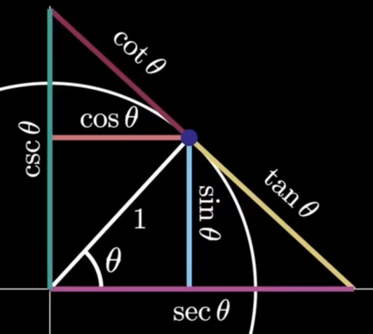
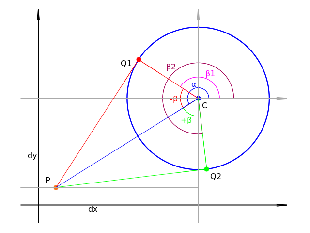
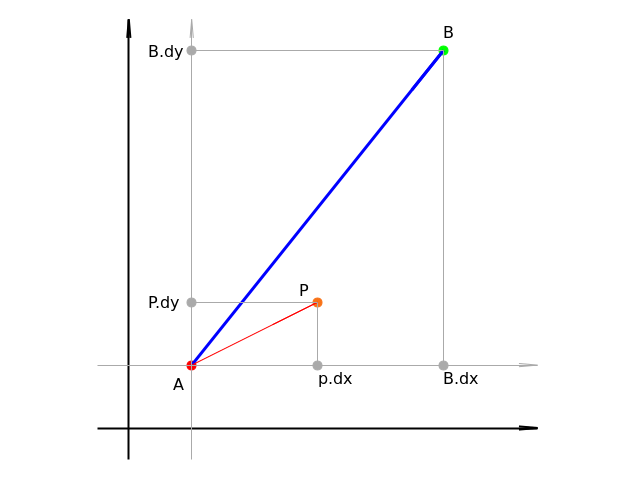
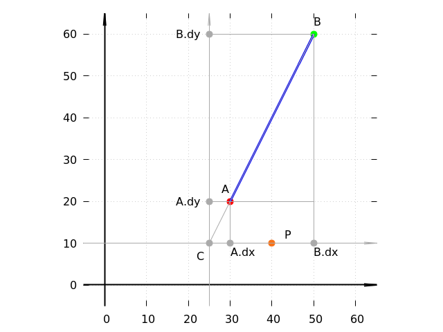
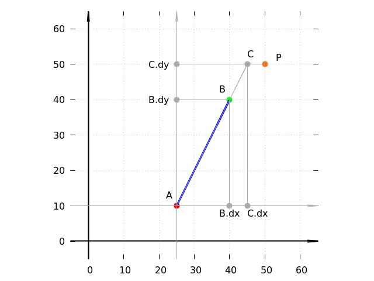
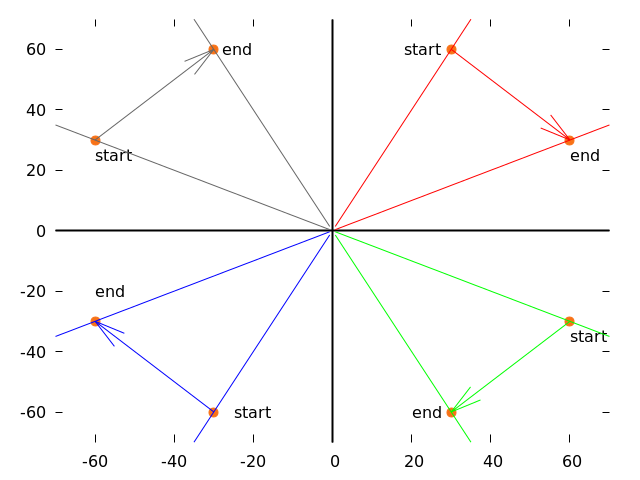
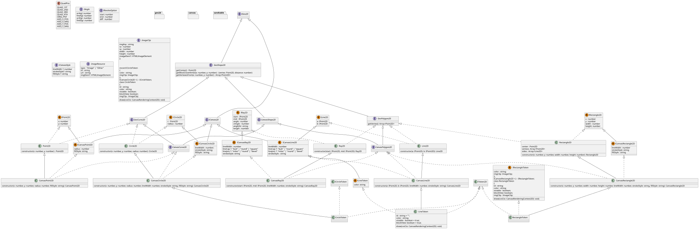

2D几何工具
=================

三角函数备忘图
-----------------



计算点到图形的切线
-----------------

### 点到圆的切线

圆外一点`P(x,y)`到圆的切线`PQ1`与`PQ2`

```javascript
Circle2D.getVertexesFrom(x: number, y: number): Array<Point2D>;
```


注意：

计算过程中都在用以圆心作为新坐标系的原点，
计算以圆心为顶点的角的角度；
如果用以点P作为新坐标系的原点，计算以P为顶点的角的角度来计算，
就要考虑到可考虑到圆在新的坐标系中不同象限时，
三角函数诱导公式的变化与符号的变化。会更加复杂。

步骤：

1. 计算线段 $dx$ 与 $dy$ 的长度分别为 $C.x - P.x$ 与 $C.y - P.y$ 。
	（注意：以圆心 $C$ 为起点）
2. 计算线段 $C \to P$ 的长度 $sqrt(dx^2 + dy^2)$ 。
3. 计算射线 $C \to P$ 的角度 $\alpha$ 等于 $arctan(dy, dx)$ 。
4. $C \to Q_1$ 和 $C \to Q_2$ 这两个射线与 $C \to P$ 的夹角 $\beta$
	分别为 $arcos(CQ / CP)$ ，等于 $arcos(r / CP)$ 。
5. 得到了 $\beta$ 这个 $C \to Q_1$ 和 $C \to Q_2$ 相对于 $C \to P$ 的夹角后，
	再加上 $C \to P$ 在坐标系中的角度 $\alpha$ ，
	就是 $C \to Q_1$ 和 $C \to Q_2$ 在整个坐标系中的角度：
	$\beta_1 = \alpha + \beta$ 和 $\beta_2 = \alpha - \beta$
6. 通过 $\beta_1$ 和 $\beta_2$ 的角度与圆的半径，
	可以得到 $Q_1$ 和 $Q_2$ 相对于圆心的坐标。
	然后再加上圆心在坐标系中的坐标就可以到`Q1`和`Q2`在坐标系中的坐标:
	* $Q_1:(c.x + r \cdot cos( \beta_1), c.y + r \cdot sin(\beta_1))$ ， 
	* $Q_2:(c.x + r \cdot cos( \beta_2), c.y + r \cdot sin(\beta_2))$

### 点到图形的切线

根据一个二维图形`shape`和外部的一点`P`，计算`P`与`shap`的两个切线的点`A`与`B`，再加上以`P`为起点的两条射线`P->A`与`P->B`：

```javascript
genVertexRaysFrom(
	x: number, y: number, shape: GeoShape2D, length?: number
): Array<{ vertex: Point2D, ray: Ray2D }>
```

判断点与直线的位置
-----------------

```javascript
export function checkPointLineSide(
	line: ILine2D, p: IPoint2D
): number;
```

### 用叉积，一个表达式搞定

判断点在直线哪一侧，用**二维叉积**（也叫外积、行列式）：

设直线方向向量 `d = B - A`，从 `A` 指向待判断点的向量 `v = P - A`，则

```
cross = d.x * v.y - d.y * v.x
      = (B.x - A.x) * (P.y - A.y) - (B.y - A.y) * (P.x - A.x)
```

* `cross > 0`：`P` 在 `A->B` 方向的**左侧**
* `cross < 0`：`P` 在**右侧**
* `cross = 0`：`P` 在直线上（含延长线）

为什么成立：二维叉积等于 `|d| * |v| * sin(θ)`，其中 `θ` 是 `d` 转到 `v` 的夹角。
`|d|` 和 `|v|` 恒为正，所以符号完全由 `sin(θ)` 决定 —— `θ` 在 `(0, π)` 内为正（左侧）、
在 `(-π, 0)` 内为负（右侧）、为 `0` 或 `π` 时叉积为零（共线）。

它的绝对值还有个额外含义：等于以 `d` 和 `v` 为邻边的平行四边形面积，
也就是 `|d| × 点到直线的距离`：

```
|cross| = |B - A| × dist(P, 直线AB)
```

所以**同一条直线上比较两个点的 `cross` 绝对值，就是在比较它们到直线的距离**，
不用开方。实测 3000 组随机输入，这个恒等式零误差。

> **注意是「点到直线」而不是「点到线段」**。垂足落在线段延长线上时，
> 点到直线的距离比点到线段的距离小 —— 后者要退到最近的端点上去量。
> 需要点到线段的距离时，得先判断垂足是否落在 `[A, B]` 之间。

### 本函数的方向约定

叉积的符号依赖 `A->B` 的方向，把 `A`、`B` 写反结果就变号。本函数不希望调用方
受书写顺序影响，所以先做方向归一化：

```javascript
// y 小的在前；y 相同（水平线）时 x 小的在前
let ll = line;
if (line.b.y < line.a.y ||
   (line.b.y === line.a.y && line.b.x < line.a.x)) {
	ll = { a: line.b, b: line.a };
}
```

归一化后方向固定为「自下而上」（水平线则为「从左到右」），于是：

* 返回**负值** = 点在该方向的左侧
* 返回**正值** = 右侧
* 返回 `0` = 在直线上

注意本函数约定左侧为负，与裸叉积相反，所以实现里把两项的相减顺序调换了：

```javascript
return (ll.b.y - ll.a.y) * (p.x - ll.a.x)
     - (ll.b.x - ll.a.x) * (p.y - ll.a.y) + 0;
```

> **与裸叉积的区别**：直接算 `cross` 时符号随 `A->B` 的书写方向翻转，
> 而本函数先归一化方向，所以对点序不敏感。两者在方向本就「自下而上」时
> 互为相反数 —— 自己写叉积判定时注意别把两套约定混用。

末尾的 `+ 0` 是把 `-0` 归一成 `+0`。共线时某一项会算出 `0 * 负数 = -0`，
使整个表达式得到 `-0`。虽然 `-0 === 0` 成立，但 `Object.is(-0, 0)` 为 `false`，
严格断言也会把两者当成不同值，容易让调用方的「是否在线上」判断踩坑。

### 曾经的分区间算法，以及它错在哪

早期实现按点的 `y` 落在哪个区间分三支处理：`P` 在两端点之间时比较
`A->B` 与 `A->P` 的角度；`P` 在端点之外时，把直线延长到 `y = P.y`
求交点 `C`，再比较 `P.x` 与 `C.x`。



求交点用的是相似三角形：

1. `(C.x - A.x) / (C.y - A.y) = (B.x - A.x) / (B.y - A.y)`
2. `C.x - A.x = (B.x - A.x) / (B.y - A.y) * (C.y - A.y)`
3. 因为 `C.y = P.y`，所以 `C.x = A.x + (B.x - A.x) / (B.y - A.y) * (P.y - A.y)`





数学推导本身没问题，但这个思路有四个坑，实现里全踩了：

| # | 坑 | 触发条件 |
|---|-----|---------|
| 1 | 第 3 步的分母 `B.y - A.y` 为 0 | **水平线**。返回 `±Infinity` |
| 2 | 三个分支的条件都是开区间，`P.y` 正好等于端点 `y` 时全部落空，返回值保持初值 `0`，等于谎报「点在线上」 | `P.y === A.y` 或 `P.y === B.y` |
| 3 | 其中一支把截距项写成 `- A.x`（应为 `+ A.x`） | `A.x !== 0`。`A.x === 0` 时碰巧看不出来 |
| 4 | 一支返回角度差、另两支返回横向距离，量纲不一致，只有符号可用 | 总是如此 |

全量扫描（端点与点各在网格上取值，共 190512 组）的实测结果：
**43212 组符号错误、21168 组返回非有限值**。

换成叉积后，四个坑一次全消：没有除法（坑 1）、没有分支（坑 2 和 4）、
没有手写截距（坑 3）。同一批 190512 组用例，修复后符号零错、非有限值零例。

**可以学到的两点**：

* 需要分很多情况讨论时，先想想有没有统一的代数表达。分支越多，
  边界条件越容易漏 —— 这里是四个分支漏了三种边界
* 几何问题优先考虑向量运算（叉积、点积），它们天然没有除法，
  也就天然没有除零和精度放大的问题

计算旋转的角度
-----------------

以点`C`为圆心，计算点`start`旋转到`end`的方向与角度：

* `c`：圆心，
* `start`：开始
* `end`：结束
* 返回：
	- `start`开始角度，
	- `end`结束角度，
	- `diff`旋转的角度

```javascript
export function revolveRay(
	c: IPoint2D, startPoint: IPoint2D, endPoint: IPoint2D
	): IRevolveOption;
```



### diff 要的是「短弧」

`diff` 的用途是给 `CanvasUtils.drawFanByRays()` 画扇形：

```javascript
cvsCtx.arc(..., revole.start, revole.end, revole.diff < 0);
```

最后那个参数是 `anticlockwise`，所以 **`diff` 的符号决定往哪边画，
绝对值决定扇形张角**。两条射线之间有两种转法（顺时针和逆时针，加起来一整圈），
画扇形要的是不超过半圈的那个 —— 即**短弧的有向角**。

### 用取模归一化，不用分象限

`Math.atan2` 的值域是 `(-π, π]`，两个角度相减落在 `(-2π, 2π)`。
把它折回 `(-π, π]` 就得到短弧：

```javascript
let diffAngle = endAngle - startAngle;
if (diffAngle > Math.PI) {
	diffAngle = diffAngle - PI_DOUBLE;     // 逆时针超过半圈 -> 改走顺时针
} else if (diffAngle <= -Math.PI) {
	diffAngle = diffAngle + PI_DOUBLE;     // 顺时针超过半圈 -> 改走逆时针
}
```

这里不需要 `while` 循环：两个 `atan2` 的差值最多偏出一整圈，一次加减就够。

几何上的意思很直白 —— 如果算出来要转超过 180°，那反方向转 `360° - |diff|`
必然更短，于是减掉一整圈换个方向。

要注意 `atan2` 的值域是 `(-π, π]`，所以 190° 这样的方位角实际返回 `-170°`，
350° 返回 `-10°`。看下面几组实测值（角度已换算成度）：

| 从 | 到 | `atan2(start)` | `atan2(end)` | `end - start` | `diff` | 是否调整 |
|---|---|---|---|---|---|---|
| 0° | 30° | 0° | 30° | +30° | +30° | 无 |
| 170° | 190° | 170° | **-170°** | -340° | **+20°** | 加一圈 |
| 190° | 170° | -170° | 170° | +340° | **-20°** | 减一圈 |
| 10° | 350° | 10° | **-10°** | -20° | -20° | 无 |
| 350° | 10° | -10° | 10° | +20° | +20° | 无 |
| 0° | 180° | 0° | 180° | +180° | +180° | 无 |

值得留意的是第 4、5 行：直觉上「从 10° 转到 350°」像是转了一大圈，
但 `atan2` 把 350° 表示成 `-10°`，原始差值本来就是 `-20°`，根本不需要调整。
**真正需要加减一圈的，只有两个角分居 `±π` 边界两侧且相距很远的情形**
（第 2、3 行）。这也是为什么一次加减就够 —— 偏差最多一整圈。

最后一行是正对 180°：两条弧都是半圈，符号在数学上任意，取 `+π` 或 `-π` 都对。
本实现用 `(-π, π]` 这个标准区间，所以 `diff > π` 才减一圈，`180°` 原样保留为 `+π`。

### 曾经的分象限算法

早期实现按两点落在哪些象限分支处理，并调 `checkPointLineSide` 判定
「跨三个象限」的情形 —— 而那个函数当时遇水平线会除零。

实测对照（圆周取 72 个点两两组合，共 5112 组）：圆心偏移到 `(37, -19)` 时
旧实现与短弧归一化**5112 组全部一致**；圆心落在原点时有 29 组不一致，
全是正对 180° 的情形，而旧实现在那里给的符号本身就不稳定（时而 `+180°` 时而 `-180°`）。

也就是说，旧实现绕了一大圈分支，算出来的就是短弧 —— 只是在边界上算错，
而且依赖了一个有缺陷的辅助函数。

**可以学到的一点**：拿到一段充满分支的几何代码时，先问「它到底在算什么」。
这里的答案是「角度差归一化」，一个标准操作、三行代码。
原来的象限判断不是必要复杂度，是没识别出标准操作而手工重造的结果。

规范化角度
-----------------

```javascript
export function formatAngle(angle: number): IAngle;
```

把任意弧度值折算到 `[0, 2π)`（对应度数 `[0, 360°)`），同时保留原值：

* `oriAgl` / `oriDgr`：原始弧度与度数，不做归一化
* `fmtAgl` / `fmtDgr`：折算到 `[0, 2π)` / `[0, 360°)`

```javascript
let fmtAgl = angle % PI_DOUBLE;              // 先折进 (-2π, 2π)
if (fmtAgl < 0) { fmtAgl += PI_DOUBLE; }     // 再把负的半圈转正
fmtAgl = fmtAgl + 0;                         // -0 归一成 +0
```

取模一步到位，不限制输入范围。早期实现写的是
`angle < 0 ? PI_DOUBLE + angle : angle` —— 只补一次 `2π`，
所以 `-3π` 补完仍是负的、`3π` 也没折回区间内，没有兑现接口声明的
`[0, 2π)` 契约。

`+ 0` 的理由和 `checkPointLineSide` 一样：`-0 % 2π` 与 `-2π % 2π` 都得到 `-0`，
而 `-0 < 0` 为假，不会进入「加一圈」的分支，结果就留下个 `-0`。

### 浮点残差

`2π` 本身是无理数的浮点近似，所以圈数很大时取模会留下残差：

```
formatAngle(100 * Math.PI).fmtAgl  ≈ 8.14e-13   // 数学上应为 0
```

这是浮点取模的固有误差，换任何写法都躲不开。**比较角度时请用容差，
不要用 `===`**：

```javascript
// 不要这样
if (formatAngle(a).fmtAgl === 0) { ... }
// 应该这样
if (Math.abs(formatAngle(a).fmtAgl) < 1e-9) { ... }
```


几条通用经验
-----------------

上面三个函数（`checkPointLineSide`、`revolveRay`、`formatAngle`）的早期实现
都出过错，修法有共性，归纳几条：

### 1. 分支多说明没找到统一表达

`checkPointLineSide` 原来按点的 `y` 落在哪个区间分三支，三个分支漏了三种边界：
水平线除零、`P.y` 正好等于端点 `y` 时全部落空、其中一支的截距符号写错。
换成一个叉积表达式后，这些边界自动消失。

判断标准很简单：**如果你在数「还有哪些情况没考虑」，大概就该换个表达方式了。**

### 2. 几何问题优先用向量运算

叉积、点积这类运算天然没有除法，也就天然没有除零和精度放大。
原实现里的 `(B.x - A.x) / (B.y - A.y)` 正是水平线崩掉的根源。

### 3. 先问「它到底在算什么」

`revolveRay` 原来按象限分支，还调了一个有缺陷的辅助函数。
但它要算的其实就是「角度差归一化到 `(-π, π]`」—— 一个标准操作、三行代码。
那堆象限判断不是必要复杂度，是没识别出标准操作而手工重造的结果。

**拿到一段充满分支的几何代码时，先用几组输入试出它的输入输出关系，
再去想有没有现成的标准操作能表达同一件事。**

### 4. 注意 `-0`

浮点里 `0` 和 `-0` 是两个值。`0 * 负数` 得 `-0`，`-0 % 任何数` 还是 `-0`，
而 `-0 < 0` 为假。

这会让「是否为零」的判断出意外：`-0 === 0` 成立，但 `Object.is(-0, 0)` 为 `false`，
严格断言也会报错。几何函数返回 `0` 表示「共线」「重合」这类特殊状态时，
加个 `+ 0` 把它归一成 `+0`。

### 5. 角度比较要用容差

`2π` 是无理数的浮点近似，涉及 `%` 或多次累加的角度运算都会留下残差
（实测 `100π % 2π ≈ 8e-13`）。**不要用 `===` 比较角度。**

### 6. 发现缺陷先用测试钉住现状

暂时不打算修的缺陷，照实写进测试并注明「这是现状，不是期望」。
这样后来真去修实现时，测试会立刻变红提示该同步更新断言。

这个约定在本库验证过两次：

* 给 `checkPointLineSide` 写的「水平线返回 ±Infinity（已知缺陷）」那条，
  修完实现后立刻变红，提示该同步更新断言
* 给 `formatAngle` 写的「超出 ±2π 归一化不了」同样如此

### 7. 零引用的函数直接删，不要留着「说不定有人用」

本库曾有 `pointToLine()` / `pointToLineDistance()` 两个函数，
前者只被后者调用、后者零引用，构成一个闭环的死代码对。
它们还带着一个不一致：轴对齐线段的两个提前返回分支没做投影参数的
`[0, 1]` 夹取，斜线分支却做了 —— 同一个函数对不同输入分别在算
「点到直线」和「点到线段」。

与其修一个没人用的函数，不如删掉。需要点到直线的距离时，
用上面的 `|cross| / |d|` 一行就能算，还不用担心夹取语义。

常用类型
-----------------

[UML说明](https://plantuml.com/zh/class-diagram)

2D常用几何类型：


