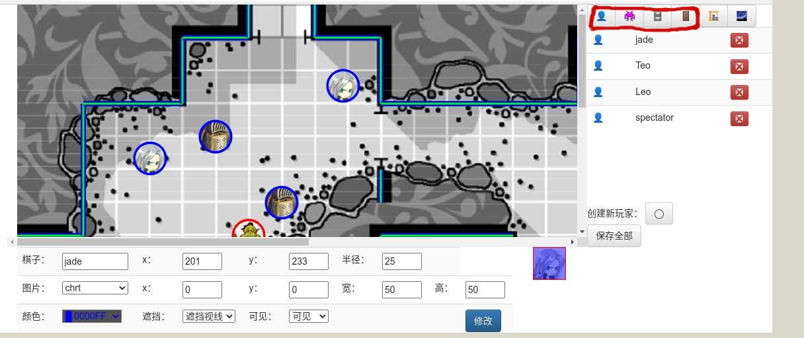
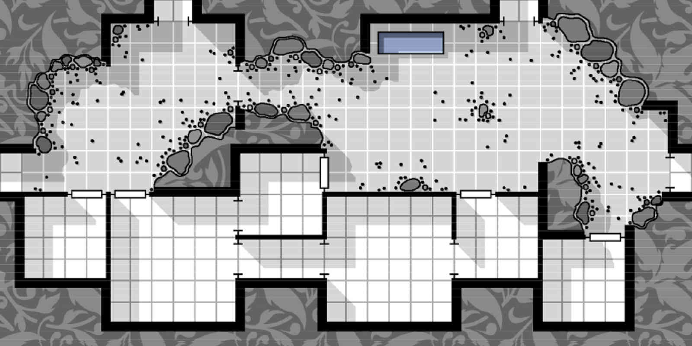

# old-sandbox-page 迁入 site-page：可行性与方案

> 读者：本项目的开发者（要动手做这次迁移的人）
> 日期：2026-11-05（四个方案已定，见第 4 节）
> 状态：**五期全部完成**（2026-11-05），剩浏览器手动验证 —— 见第 11 节

把 `old-sandbox-page/`（旧 TRPG 沙盘应用，原生 JS + jQuery + Bootstrap 3）
迁进 `site-page/`，成为新模块 `sandbox`，界面改成 `test-jade-trpg-ui.html`
那套仿 win98 的窗口风格。

**结论先放这里**：可行，工作量**不是**「2600 行 JS 翻译成 TS」。
真正要写的新代码约 **1500 行**，因为几何与渲染层
[已经在上一轮重构里移植过了](#2-已经有的和还缺的)。

[第 4 节](#4-已定的四个方案)的四个方案已经定了（字段名兼容、图片 URL、
两个老 bug、帮助文档），**三处兼容/修复逻辑都是纯函数、全都能写单元测试**。
剩下的主要风险是 Canvas 渲染没法自动化验证（jsdom 不实现 `getContext('2d')`）。

---

## 1. 老应用是什么

四个页面、五个脚本，共 2342 行 JS（不含 `base.js`，见下）：

| 文件 | 行数 | 职责 |
|------|-----:|------|
| `canvas2dutils.js` | 974 | 几何计算 + Canvas 图形类 + 观察者视野/阴影 |
| `sandtable-comm.js` | 478 | Cookie、URL 参数、图片加载、Token 序列化、**10 个 jQuery AJAX 封装** |
| `sandtable-editor.js` | 541 | 场景编辑器：Token 增删改、属性面板、保存发布、掷骰阈值 |
| `sandtable-view.js` | 274 | 玩家视图：视野渲染、拖拽申请移动、掷骰 |
| `sandtable-index.js` | 75 | 登录 / 注册 |

页面：

| 页面 | 作用 |
|------|------|
| `sandtable-index.html` | 登录 + 填战役/地区/场景 → 跳转到 view 或 editor |
| `sandtable.html` | 玩家视图（带战争迷雾） |
| `sandtable-editor.html` | GM 编辑器（无迷雾，看全图） |
| `sandtable-readme.html` | 帮助文档（纯静态，19 张截图）。**不迁**，见 [4.4 节](#44-帮助文档-已搬完转成-markdown) |

**`base.js`（289 行）不用迁** —— 四个沙盘页面没有一个加载它，
里面是老博客的 `imgPlaceHolder` 之类，已在 `site-page/blog/common.ts` 里有了。

### 1.1 三级定位与两种角色

场景由 `campaignId / placeId / sceneId` 三级定位，全部走 URL 参数。
角色分两种，**差别只在前端**：

- **玩家**（view）：只看得见视野内的东西，拖自己的棋子 → 提「移动申请」
- **GM**（editor）：看全图、改 Token、保存发布、给玩家设掷骰阈值

后端不区分页面，只在 `save-map` 校验「你是不是这个战役的 owner」。

---

## 2. 已经有的和还缺的

**这是本方案的关键事实**：`site-page/src/main/ts/trpg/sandtable.ts`（671 行）
已经是老 `canvas2dutils.js` 的 TypeScript 移植版，`common-utils` 的
`ui/geo2d.ts` + `ui/canvas.ts` 则吃掉了几何层。

### 2.1 几何与纯函数：全部有了

| 老代码 | 新位置 | 备注 |
|--------|--------|------|
| `distanceP2P` | `Geo2DUtils.distanceP2P` | 签名从 4 个数变成 2 个 `IPoint2D` |
| `pointOfLineSide` | `Geo2DUtils.checkPointLineSide` | ⚠️ **符号约定不同**，见下 |
| `segmentsIntr` | `Geo2DUtils.segmentsIntr` | |
| `quadOfPoint` / `quadOfLine` | 同名 | |
| `Ray` 类 | `Ray2D` / `CanvasRay2D` | |
| `Canvas2dShape` | `CanvasShape2D` | |
| `minDistance(x,y)` | `getMostCloseVertex(x,y)` | 返回 `{vertex, distance}` |
| `genVertexRays` | `Geo2DUtils.genVertexRaysFrom` | |
| `filterObstacleRays` | `Geo2DUtils.filterObstacleRays` | |
| `drawLine` / `drawLines` | `CanvasUtils` | |

⚠️ **`checkPointLineSide` 的符号和老的裸叉积相反**（根 CLAUDE.md 有记）：
它先把端点按 y 排序，语义是「相对自下而上方向的侧」，且**约定左侧为负**。
老代码的 `pointOfLineSide` 是裸叉积。**照搬老代码的判断会左右反**。

### 2.2 Token 与视野渲染：有了

| 老类 | 新类 | 文件 |
|------|------|------|
| `Line` | `LineToken` | `trpg/sandtable.ts` |
| `Rectangle` | `RectangleToken` | 同上 |
| `Circle` | `CircleToken` | 同上 |
| `Observer` | `IObserver` + `SandTableUtils` | 同上 |
| `loadMapDatas` 的渲染部分 | `SandTable.drawSceneWithUserView` | 同上 |
| `drawObstatleShadows` | `SandTableUtils.drawDarkScene` / `drawBrightScene` / `drawScopeOfVisionOnDarkMap` | 同上 |
| `tokenToData` / `dataToToken` | 各类的 `toRecord()` / `fromRecord()` | 同上 |
| `loadImage` + 代理 | `WebUtil.loadImageByProxy` | `common-utils/web.ts` |
| 图片资源批量加载 | `SandTableUtils.loadImageResources` | `trpg/sandtable.ts` |

`testJadeTRPG.ts` 的 `testTrpgUI()` 已经把「窗口 + Canvas + 迷雾渲染」
跑通了，**可以直接当 view 页的骨架**。

### 2.3 缺的：编辑交互 + 全部网络层 + 全部 UI

| 缺什么 | 老代码位置 | 估计行数 |
|--------|-----------|---------:|
| Token 的 `isHit(x,y)` 命中测试 | 三个类各一份 | ~60 |
| Token 的 `move` / `scale` / `onMoveing` / `onScaleing` | 三个类各四份 | ~200 |
| Token 的 `drawDesign()`（编辑器里不带迷雾的画法） | 三个类各一份 | ~70 |
| Token 的 `clone()` | 三个类各一份 | ~30 |
| 10 个 API 调用（jQuery AJAX → `WebUtil.requestHttp`） | `sandtable-comm.js` | ~180 |
| 窗口 UI（见[第 5 节](#5-界面改造窗口怎么分)） | 两个 HTML + editor 的 DOM 操作 | ~450 |
| 场景状态管理（六个 Map + 列表的增删同步） | `sandtable-editor.js` 散落各处 | ~120 |

`drawNextLocation` 已经有了（对应老的 `onWantMoveing`），只有 `CircleToken` 一份。

**合计约 1110 行新代码**，其中 360 行是往现有 Token 类上补方法 ——
这部分**建议补在 `trpg/sandtable.ts` 里**，不要在 sandbox 模块里另写一套。

---

## 3. 接口对账：site-api vs 老应用

老应用调 11 个接口。**逐个比对过请求参数与响应字段**，结果：

### 3.1 对得上的（9 个）

| 接口 | 方法 | 老代码读的字段 | site-api 返回 | 结论 |
|------|------|--------------|--------------|------|
| `/api/sandtable/load-map` | GET | `imgResources`, `mapDatas` | 原样返回存的 JSON + `status` | ✅ |
| `/api/sandtable/save-map` | POST | `status` | `{status, msg}` | ✅ 见 3.3 |
| `/api/sandtable/map-owner` | GET | — | `{status, msg, owner}` | ✅ 老代码**根本没调**，死代码 |
| `/api/sandtable/load-move-request` | GET | `data[].userId`, `data[].pos.{x,y}` | `IMoveRequest{userId, pos}` | ✅ |
| `/api/sandtable/request-move` | GET | `status` | `{status}` | ✅ 负坐标=撤销，两边一致 |
| `/api/sandtable/roll-dice` | GET | `data` | `{status, data}` | ✅ |
| `/api/sandtable/get-roll-result` | GET | `data[].{userId,threshold,sum,msg}` | `IRollResultRow` 同名四字段 | ✅ |
| `/api/sandtable/set-roll-threshold` | GET | `status` | `{status, data}` | ✅ |
| `/api/sandtable/parseImage` | GET | `?src=` | 读 `params.src` | ✅ |
| `/api/auth/login` | POST | `data.username`, `data.token` | 同名 | ✅ |
| `/api/auth/regist` | POST | `data.username` | 同名 | ✅ |

### 3.2 行为差异（不用改前端，但要知道）

- **`save-map` 现在强制校验 token**，身份从 `jsonStr` 里的 `loginToken` 取，
  不再信 `payload.username`。老 editor 的 `seriseMapData()` 本来就把
  `username` 和 `loginToken` 都塞进去了，所以**无需改前端**
- **`request-move` 的 token 是可选的**：带了就以 token 为准，没带就信客户端
  声明的 `username` 并打告警。老代码不带 token —— 迁移时**建议顺手带上**，
  `site-api/docs/todo-next.md` 的 1.1 正等着前端这一步
- **`load-map` 失败返回 `status: 'error'`**（不是 `'err'`）。老代码只判
  `'success'`，所以走 reject 分支，不影响

### 3.3 一个要注意的编码细节

老 editor 用 jQuery `data: {jsonStr: ...}` 发 POST，jQuery 会自动
form-encode 并设 `Content-Type: application/x-www-form-urlencoded`。

**`WebUtil.requestHttp` 不设任何 Content-Type**，`xhr.send(req.body)` 直接发。
所以迁移时必须显式设头并自己编码：

```typescript
let headers = new SimpleMap([["Content-Type", "application/x-www-form-urlencoded"]]);
await WebUtil.requestHttp({ method: "POST", url: saveUrl,
    opt: { headers: headers },
    body: `jsonStr=${encodeURIComponent(jsonStr)}` }, { onLoad: ... });
```

后端挂了 `express.json()` 和 `express.urlencoded()` 两个中间件，
所以发 JSON 也行 —— 但**得设对应的头**，不设的话两个中间件都不解析，
`data.params.jsonStr` 是 `undefined`，后端回 `miss params`。

---

## 4. 已定的四个方案

2026-11-05 决策，下面四条都已确定，**不再是待议项**。

### 4.1 `visiable` → `visible`：读时兼容

**背景**：后端只存整块 JSON、不解析任何字段（`save-map` 只取 `loginToken`），
所以存量数据里是哪个拼写，读出来就是哪个。

| 哪边 | 拼写 | 证据 |
|------|------|------|
| 老代码 + **存量数据** | `visiable`（拼错的） | 样例场景文件里 **57 处 `visiable`、0 处 `visible`** |
| 现成的 `trpg/sandtable.ts` | `visible`（正确的） | `IToken2DRec.visible`，0 处 `visiable` |

**决定：读时兼容两种拼写，写时只写 `visible`。**

```typescript
/**
 * Token 记录。
 *
 * `visiable` 是**存量数据的拼写错误**（`visible` 之误）。
 * 老沙盘应用一直这么存，后端不解析字段所以原样留着了。
 * 读的时候两种都认、**写的时候只写 `visible`** ——
 * 所以每个场景在 GM 第一次「保存并发布」之后就自动转正了。
 *
 * ⚠️ 这个过渡字段**不能提前删** —— 删了之后没转正过的场景会变成
 * 「整张图的棋子全部隐形」，而且不报错（`undefined` 按 falsy 处理）。
 * 要删得先确认 Redis 里所有场景都已经重存过一遍。
 */
export interface IToken2DRec {
	visible  : boolean;
	/** @deprecated 存量数据兼容，见上。新数据不写这个字段 */
	visiable?: boolean;
}
```

三处 `fromRecord()` 各改一行：

```typescript
// CircleToken / RectangleToken / LineToken 的 fromRecord 都这么写
visible: rec.visible ?? rec.visiable ?? false,
```

**为什么兜底是 `false` 而不是 `true`**：两个拼写都没有时，说明这条记录
既不是新数据也不是老数据（字段真缺了）。棋子隐形是**可观测的异常**，
而默认可见会把「数据有问题」伪装成「一切正常」。

**`toRecord()` 不要写 `visiable`** —— 写了就永远转不正。

必须有的测试（期 1）：

| 用例 | 断言 |
|------|------|
| 读老数据（只有 `visiable`） | `visible` 取到 `visiable` 的值 |
| 读新数据（只有 `visible`） | 正常 |
| 两个都有且冲突 | **`visible` 优先**（`??` 的语义） |
| 两个都没有 | 得到 `false`，不是 `undefined` |
| `toRecord()` 的输出 | **不含 `visiable` 键** |
| 老数据 → `fromRecord` → `toRecord` 往返 | 输出只有 `visible`，值不变 |

最后那条是「自动转正」的保证，必须有。

### 4.2 图片 URL：用绝对地址

**决定（2026-11-05 修订）：场景数据里的图片 URL 用绝对地址，不用相对路径。**

> 本节初版定的是「用相对路径 + 存裸文件名 + 读时接 `assetRoot`」。
> 查清三张本地图片的实际用途之后改了 —— 理由见下，不是偏好问题。

#### 为什么绝对地址更好：代理只对跨源 URL 生效

关键事实在 `web.ts` 的 `resolveImageUrl()`（第 221 行）：

```typescript
const parsed = new URL(url, location.href);
return { isCrossOrigin: parsed.origin !== location.origin, absUrl: parsed.href };
```

相对路径按 `location.href` 解析 → **判定为同源 → 不走代理**。
而 `parseImage` 代理存在的唯一目的就是绕开跨源图片对 canvas 的污染
（污染后 `getImageData()` 会抛错）。

**生产场景数据里的图片是 GM 自己配的，大概率指向外部 CDN** ——
那本来就是跨源绝对 URL，正是代理要处理的形态。
用相对路径等于把数据往「不需要代理」的方向拧，和实际用法相反。

三条理由，按重要性排：

| | 理由 |
|---|------|
| 1 | **生产数据天然是绝对 URL**（外部 CDN 的图），代理机制也是为它建的 |
| 2 | 相对路径把数据**耦合到页面的目录深度** —— 老数据就是这么坏掉的（见下） |
| 3 | 绝对 URL 在数据里是自描述的，不依赖「读的时候接哪个 `assetRoot`」这层约定 |

#### 相对路径的具体坏法（老数据的教训）

老页面在 `webroot/` 根上、图片在 `webroot/images/sandtable/`，
所以存 `./images/sandtable/map.jpg` 是对的。新页面深两层：

| | 页面位置 | `./images/sandtable/map.jpg` 解析到 |
|---|---|---|
| 老 | `webroot/sandtable.html` | ✅ `webroot/images/sandtable/map.jpg` |
| 新 | `webroot/html/sandbox/view.html` | ❌ `webroot/html/sandbox/images/sandtable/map.jpg` |

而 `loadImageByProxy` 的失败分支是**静默换占位图**，不抛错 ——
表现是「地图变成一张 50×50 的灰色小图」，不是报错。

**同一份数据换个页面位置就坏，这是相对路径的固有问题**，
不是老代码写错了。换成绝对 URL 就不存在这个问题。

#### 存量老数据怎么办：一个最小兼容分支

存量数据里确实有相对路径，但**它们指向的文件要么是 demo 资源、要么根本不存在**
（见[第 4.2.1 节](#421-三张本地图片的实际用途)）。所以兼容分支只要保证
「不崩、能看出哪里不对」，不需要真修好：

```typescript
/**
 * 把场景数据里的图片 URL 归一化
 *
 * **新数据一律是绝对 URL**，这个函数对它们原样放过。
 * 相对路径只出现在**老沙盘应用存下的数据**里 —— 老页面在 webroot/ 根上，
 * 存的是 `./images/sandtable/xxx.jpg`。新页面在 webroot/html/sandbox/ 下，
 * 相对基准变了，原样用会 404（而且是静默换占位图、不报错）。
 *
 * 所以这里把老相对路径接到 assetRoot 上，至少落在正确的目录里。
 *
 * ⚠️ **接对了也多半还是 404** —— 老数据引用的 5 张 png
 *（char.png / solider01.png / moster.01.png / door-wood.png / map.png）
 * 在老项目里就不存在，另外 3 张 jpg 是 demo 资源、本模块不发。
 * 这个分支的作用是「让它落在可解释的位置」，不是「修好它」。
 * GM 需要在编辑器里重新指定图片。
 *
 * @param url - 场景数据里的 URL
 * @param assetRoot - 老相对路径的落点，由页面从 envs.js 注入
 */
export const normalizeImageUrl = (url: string, assetRoot: string): string => {
	if (!url) { return url; }
	// 绝对地址与协议相对地址：新数据的正常形态，原样放过（走 parseImage 代理）
	if (/^(https?:)?\/\//.test(url)) { return url; }
	// data: / blob: 内联数据也不动
	if (url.startsWith('data:') || url.startsWith('blob:')) { return url; }
	// 剩下的是老数据的相对路径，按文件名接到 assetRoot
	return `${assetRoot}/${url.split('/').pop()}`;
};
```

**`toRecord()` 存什么：原样存 `this.url`。**
新数据本来就是绝对 URL，不需要任何加工 —— 这比初版的「存裸文件名」简单，
也不再需要「读的时候接 `assetRoot`」这层约定。

| 数据里存的 | 读出来 | 来源 |
|-----------|-------|------|
| `http://cdn.x/img/orc.png` | 原样，走代理 | **生产数据的正常形态** |
| `//cdn.x/img/orc.png` | 原样，走代理 | 协议相对，同上 |
| `./images/sandtable/map.jpg` | `<assetRoot>/map.jpg` | 老数据，多半仍 404 |

#### 4.2.1 三张本地图片的实际用途

查清楚了，三张各不相同：

| 图 | 大小 | 真实用途 | 本模块要不要 |
|---|-----:|---------|------------|
| `default.jpg` | 961 B | **和 `web.ts` 里那张 base64 兜底图是同一张，md5 完全相同** | ❌ 不要，见 4.2.2 |
| `icons.jpg` | 21 KB | demo 用的图标表（`testJadeTRPG.ts` 在用） | ⚠️ **文件留着**，但 sandbox 不依赖 |
| `map.jpg` | 86 KB | demo 用的示例地图（同上） | ⚠️ 同上 |

**`icons.jpg` / `map.jpg` 的文件不能删** —— `testJadeTRPG.ts` 的
`testSceneData`（第 23、25 行）和 `testTrpgUI()`（第 440 行）正在用它们，
那个 demo 就是本次迁移的 win98 参照页 `test-jade-trpg-ui.html`。
删了参照页就坏了。

但**sandbox 模块本身对这两张图零依赖** —— 生产场景的图由 GM 配置。
所以：文件留在 `themes/trpg/images/`，sandbox 代码里不出现它们的名字。

#### 4.2.2 `default.jpg` 可以删

**它和库里那张 base64 兜底图是同一张图**，实测：

```
web.ts 的 base64 兜底图 md5: 41c2564170f010cea9081c9c620842e8
default.jpg            md5: 41c2564170f010cea9081c9c620842e8
                            ✅ 完全相同（961 字节，50×50）
```

老代码在 `load-map` 失败时拿它当兜底场景的图
（`sandtable-comm.js:462`），但那个兜底 token 是 `visiable: false` ——
而老代码 `if (tokens[p].visiable) { tokens[p].draw(); }`，
**隐形 token 根本不画**。所以它加载了却从没显示过。

新代码不需要它：图片级的加载失败兜底已经由 `loadImageByProxy` 内置
（失败就换 `defaultImgData`，就是这张图的 base64 形式）。

查过没有别的消费方（gulpfile 和 12 个页面都没引用），所以：

| 动作 | |
|------|---|
| 从 `site-page/src/main/themes/trpg/images/` 删掉 `default.jpg` | ✅ 安全 |
| sandbox 的失败兜底 | 靠 `loadImageByProxy` 内置的 base64，不引外部文件 |

> 顺带发现一处注释错误：`web.ts:139` 写的是
> 「默认占位图片（Base64 编码的 **1x1** 灰色 JPEG）」，
> 实测解码后是 **50×50**。不影响功能，**不在本次迁移范围内**，记在这里。

#### 4.2.3 favicon：已经是绝对地址了

这一条不用做任何事。现状：

- `parts/favicon.html` 就一行，用的是
  `@@staticRoot/themes/site/images/favicon.ico?v=@@buildversion` —— **绝对地址**
- 10 个需要 favicon 的页面全部通过 `parts/head.html` 间接 include 它，
  没有一个页面手写（查过：提到 favicon 的 11 个文件里，第 11 个是片段自己）
- **老沙盘的 4 个页面压根没有 favicon**（`grep -c favicon` 全是 0），
  所以不存在「迁过来要改」的问题

新 sandbox 页面只要 include `parts/head.html` 就自动有了，
**老项目那 6 个 `.ico` 文件不用迁** —— 站点有自己的 favicon。

你的判断是对的（网站级资源该用绝对地址），而且这件事本项目已经做到了 ——
规则写在根 CLAUDE.md 的「页面引资源：按归属选 root」那一节。
### 4.3 两个老 bug：都修

**决定：迁移时一起修掉，并写回归用例。**

| bug | 位置 | 现象 |
|-----|------|------|
| `rollResult.lenght` 拼错 | `sandtable-view.js:252` | `for(i=0; i < undefined; i++)` → 循环零次。**玩家视图的掷骰结果永远是空的**，不报错 |
| `queryRollResult` 引用未定义的 `username` | `sandtable-editor.js:518` | 函数被 `#logInfo` 的 onClick 调用，一点就抛 `ReferenceError` |

两个 bug 的共同点：**都在掷骰结果显示这条路径上，都是静默失败。**
合起来的效果是「掷骰功能看着能用（请求发出去了、后端也存了），
但谁都看不到结果」。

#### 修法

`lenght` → `length`。editor 那份（`sandtable-editor.js:524`）拼写本来是对的，
所以**两份渲染逻辑应该合成一个函数** —— 它们的差别只有 editor 多显示一行阈值。

```typescript
/**
 * 把检定结果渲染成文本
 *
 * ⚠️ 老代码有两份实现，view 那份把 `length` 拼成了 `lenght`
 *（`sandtable-view.js:252`），导致玩家侧永远渲染不出东西、且不报错。
 * 迁移时合成一个函数并修掉，`showThreshold` 区分两种用法。
 */
export const renderRollResults = (
	rows: Array<IRollResultRow>, showThreshold: boolean,
): string => {
	let text = '';
	for (const rec of rows) {   // for...of，不会再拼错属性名
		text += `* ${rec.userId}    `;
		if (showThreshold) { text += `阈值：${rec.threshold}\n`; }
		text += rec.sum > 0
			? `  ${rec.sum < rec.threshold ? '失败' : '成功'}：${rec.msg}\n`
			: '  等待中……\n';
	}
	return text;
};
```

`username` 那个：editor 侧的 `queryRollResult()` 根本不需要 username ——
`get-roll-result` 查的是**全场**结果，接口只收三级定位参数
（见 [3.1 节](#31-对得上的9-个)的对账表）。老 view 那份传了 username 也是多余的。
**新实现签名里不要 username。**

#### 必须有的回归用例（期 2）

| 用例 | 断言 |
|------|------|
| 非空结果列表 | 每条都出现在输出里（**这条就是 `lenght` bug 的回归**） |
| `sum > 0` 且 `sum < threshold` | 输出含「失败」 |
| `sum > 0` 且 `sum >= threshold` | 输出含「成功」 |
| `sum === 0` | 输出含「等待中」 |
| `showThreshold: false` | 输出**不含**「阈值」 |
| 空列表 | 返回空串，不抛错 |

第一条是关键 —— 老代码的 bug 恰好是「列表非空但输出为空」，
所以用例必须断言**内容出现了**，光断言「不抛错」测不出来。

### 4.4 帮助文档：✅ 已搬完，转成 Markdown

**决定（2026-11-05 修订）：19 张 `smp-*.jpg` 挪到 `site-page/docs/images/into/`，
`sandtable-readme.html` 转成 Markdown、不作为站点页面发布。**

**这一条已经做完了** —— 见下面的「具体动作」。本节剩下的内容是**为什么这么定**，
动工时不用再读。

> 初版定的是「页面照搬 + 只改 `<head>` 和图片路径」。
> 把截图挪进 `docs/` 之后那条做不到了 —— 理由见下。

#### 为什么页面跟着就不能迁了

`site-page/docs/` **不发到 CDN**。`site-page/build.sh` 只有一条拷文档的步骤：

```bash
cp -r ../common-utils/docs    webroot/      # 拷的是**库的**文档
```

所以截图一旦挪进 `site-page/docs/images/`，它们就**不在 CDN 上**。
而 `readme.html` 如果还作为站点页面发出去（`webroot/html/sandbox/readme.html`），
它引用的 19 张图全部 404。

两者只能二选一：

| 方案 | 截图位置 | 文档形态 | 读者 |
|------|---------|---------|------|
| **A（已定）** | `site-page/docs/images/` | **Markdown**，放 `site-page/docs/` | 开发者，在 git / IDE 里看 |
| B | `themes/trpg/images/` | HTML 页面，发 CDN | 站点访客 |

**你选的是 A**（截图进 `docs/`），而且说了「会自己重新写文档重新截图」——
那正好是开发者文档的工作方式。所以 `readme.html` 不用迁，
你之后直接在 `site-page/docs/` 下写一篇 `.md` 即可。

#### 具体动作：✅ 已完成（2026-11-05）

| 做什么 | 结果 |
|-------|------|
| 19 张 `smp-*.jpg`（624 KB） | ✅ 已在 `site-page/docs/images/into/` |
| `sandtable-readme.html`（388 行） | ✅ 已转成 [sandtable-readme.md](sandtable-readme.md)，HTML 已删 |

**转换是逐字的** —— 校验过去掉空白后两边正文各 1968 字、完全一致，
23 处图片链接全部指得到真实文件，19 张图全部用上。

原 HTML 在 git 历史里（`cd9546c`），要翻原件：

```bash
git show cd9546c:old-sandbox-page/src/html/sandtable-readme.html
```

两点转换时的处理：

- **原文那 7 处笔误没改**（`非完家生物`、`Ctril`、`加车键` 等），
  照实保留并在 md 顶部的注释块里列了一张表 —— 你重写时可以一并修掉
- **唯一改了语义的地方**：「旁观者」一节的两处 `spectator` 外面原本是
  **字面反引号**（写在 `<p>` 里，HTML 渲染成可见的 ` 字符），
  而同篇别处用的是 `<code>` 标签。作者本意显然是代码标记，所以转成了真 code span

Markdown 引图照 `common-utils/docs` 的现成写法 —— 相对路径、图放子目录：

```markdown

```

两张非 `smp-*` 的图（`map.jpg` / `icons.jpg`）**没有复制一份到 `docs/`**，
md 里跨目录引的源码树：

```markdown

```

路径有点长，但避免了同一张图在仓库里存两份。
这两张是 demo 资源、`testJadeTRPG.ts` 在用，所以留在 `themes/` 下
（见 [4.2.1 节](#421-三张本地图片的实际用途)）。

（那棵树里就是这么写的，例如 `](uml/out/ui-style-win98.svg)`）

#### 两点要知道

- **`icons.jpg` / `map.jpg` 老 readme 也在用**（当「图片资源长什么样」的示例）。
  它们留在 `themes/trpg/images/`（demo 在用，见 [4.2.1 节](#421-三张本地图片的实际用途)），
  **新文档要引的话得用相对路径跨目录**，比如
  `../../site-page/src/main/themes/trpg/images/icons.jpg` —— 很丑。
  建议**需要的话在 `docs/images/` 下另存一份**，文档的图归文档
- **这 624 KB 不进 CDN 产物了**，是顺带的好处 ——
  原来按初版方案它们会被 `process-style-trpg` 拷进 `webroot/themes/trpg/images/`
  发出去，而站点访客里几乎没人看那篇旧界面文档

#### gulp 任务：不用改，但也不会带上

`process-style-trpg` 的拷贝源是 `gulp.src(['src/main/themes/trpg/images/*'])`
（`site-page/gulpfile.js:123`）—— **`site-page/docs/` 不在它的范围里**，
所以截图不会被打进产物。这正是想要的。

HTML 任务（`htmlSrc = "src/main/html/"`，`**/*.html` 通配）同理 ——
新建 `src/main/html/sandbox/` 子目录会被自动捞到，不用改配置。
只是这次没有 `readme.html` 要捞了。


### 4.5 `map` 图片是硬依赖

`initSence()` 直接 `imageMap.get('map').image.img.width` 取场景尺寸。
**`imgResources` 里没有 id 为 `map` 的项就崩**（`undefined.image`）。
老代码在 `loadMapDatas` 的 catch 分支里兜了一份兜底数据，但正常分支没兜。

**决定：要。** 没有校验时的报错是 `Cannot read properties of undefined (reading 'image')`，
指向 `initSence()` 里一句取宽高的代码，看不出「是数据缺了 `map` 这一项」。
加一句显式校验，抛出带场景三级 ID 的可读错误。

### 4.6 ⚠️ 几何层是不可变的，`move`/`scale` 不能原地改

**动工时发现的架构约束**（2026-11-05，期 1 开工后补记）。

老代码的编辑交互是**原地改坐标**：

```javascript
move(x, y, x1, y1) { this.x = x1 - x + this.x; ... }   // 老代码
```

但 `common-utils` 的几何层**整个是不可变的**：

| 类 | 字段 |
|---|------|
| `Point2D` | `readonly x`, `readonly y` |
| `Circle2D` | `readonly c`, `readonly radius` |
| `Line2D` | `readonly a`, `readonly b` |
| `Rectangle2D` | `readonly x/y/width/height` |

**而且 `Rectangle2D` 在构造函数里就把派生数据算好缓存了** ——
`center`、`vertexs`（4 个顶点）、`sides`（4 条边）都是 `private readonly`。

所以**强行 `as any` 改 `x` 会制造一个静默错误**：
`getVertex()` / `getVertexesFrom()` 返回的还是旧位置的顶点，
于是碰撞检测、视线阻挡、阴影投射全部按**旧位置**算，而图形画在新位置。
表现是「棋子挪开了但影子没跟着动」，不报错。

**结论：`move` / `scale` 返回新实例，不原地改。**

```typescript
/**
 * 平移后的新 Token
 *
 * ⚠️ **返回新实例，不改当前对象** —— 几何层的坐标字段是 `readonly`，
 * 而且 `Rectangle2D` 把顶点与边缓存在构造函数里。原地改坐标会让缓存失效，
 * 导致碰撞检测与阴影投射静默按旧位置计算。
 */
moveTo(dx: number, dy: number): CircleToken { /* 返回 new CircleToken(...) */ }
```

**连带影响**：编辑器拖完棋子要把场景的 Map/List 里那一项**换成返回的新实例**，
不能只改引用指向的对象。这一点在期 4 实现 `sandboxScene.ts` 时要注意。

命名用 `moveTo` / `scaleTo` 而不是老的 `move` / `scale` ——
后者在读者眼里像原地修改，而这里不是。

---

## 5. 界面改造：窗口怎么分

参照 `test-jade-trpg-ui.html`：一个 `.desktop` 容器 + `UIDesktop` +
继承 `UIWindowAdapter` 的窗口类，`JadeWindowUI.renderWindowTplt` 渲染。
98.css 负责外观。

### 5.1 老界面的面板清单

editor 页面有 7 个区块（`#mapArea`、`#ctrlPanel`、`#propImgArea`、
`#tokenGroupBtns` + `#tokenListArea`、`#createTokenArea` + `#optSaveBtnsArea`、
`#logInfoArea`、`#rollDiceArea`），全靠 `resizeLayout()` 手算 7 个
`clientHeight` 再减出地图高度。view 页面只有 2 个（地图 + 侧栏）。

### 5.2 建议的窗口划分

| 窗口 | 内容 | 玩家 | GM |
|------|------|:----:|:--:|
| **Map** | Canvas（buffer + final 两张，buffer 隐藏） | ✅ | ✅ |
| **Tokens** | 六个分组按钮 + Token 列表 + 创建按钮 | — | ✅ |
| **Properties** | Token 属性表单 + 图片裁剪预览 Canvas | — | ✅ |
| **Dice** | 掷骰输入 / 阈值设定 + 结果日志 | ✅ | ✅ |
| **Scene** | 战役/地区/场景 + 保存发布 / 刷新请求 | — | ✅ |

登录页建议**不做成窗口** —— 它是进入应用之前的一步，
做成普通页面（98.css 的 `fieldset` + `field-row`）更合适。
或者做成一个不可关闭的登录窗口，但那样「未登录」状态要额外管。

**`resizeLayout()` 整个删掉** —— 窗口自己管大小，这是换窗口 UI 最大的收益。
老代码那 20 行手算高度的逻辑连 `ctrlPanel` 都取了但没用上
（`sandtable-view.js:98`，取了 `ctrlPanel` 然后只用常量 150）。

### 5.3 98.css 够用

查过 `node_modules/98.css/dist/98.css`，编辑器要的控件全有：

| 要什么 | 98.css 提供 |
|--------|------------|
| 文本框 / 下拉 / 多行 | `input` / `select` / `textarea`（原生标签直接生效） |
| 按钮 | `button`、`button.default` |
| Token 列表 | `table.interactive` + `tr.highlighted` 做选中态 |
| 列表容器 | `.sunken-panel`（带内凹边框，适合列表区） |
| 表单行 | `.field-row` / `.field-row-stacked` |
| 分组 | `fieldset` / `legend` |
| 窗口状态栏 | `.status-bar` / `.status-bar-field` |

**不需要自己写表单样式。** 注意 98.css 是声明过的可选 peer 依赖，
页面要 include `parts/vendor-98css.html` + `parts/theme-window-ui.html`
（后者引的是**库侧**产物，走 `@@libRoot`）。

### 5.4 坐标换算要重写

老代码用 `sumCanvasOffset()` 递归累加 `offsetLeft/offsetTop`，
**两份实现符号还相反**（view 是减、editor 是加）。
窗口可拖动、可滚动之后这套必然失效。

`testJadeTRPG.ts` 里已经示范了正确做法：

```typescript
let rect = finalCanvas.getBoundingClientRect();
let x = e.clientX - rect.left;
let y = e.clientY - rect.top;
```

**用这个，别搬 `sumCanvasOffset`。**

---

## 6. 模块结构与登记

```
site-page/src/main/ts/sandbox/
├── sandboxApi.ts      10 个接口的 TS 封装（替代 sandtable-comm.js 的 AJAX 部分）
├── sandboxScene.ts    场景状态：六个分组的 Map/List 维护、序列化
├── sandboxView.ts     玩家视图：视野渲染 + 拖拽申请移动 + 掷骰
├── sandboxEditor.ts   GM 编辑器：Token 增删改 + 保存发布 + 阈值
├── sandboxWindows.ts  5 个窗口类（继承 UIWindowAdapter）
└── sandboxLogin.ts    登录 / 注册

site-page/src/main/html/sandbox/
├── index.html         登录 + 选场景
├── view.html          玩家视图
└── editor.html        GM 编辑器
                       （没有 readme.html —— 见 4.4 节，文档改成 Markdown）

site-page/docs/                 ← 这棵树**不发 CDN**，读者是开发者
├── sandbox-refactor.md         本文
├── sandtable-readme.md         使用说明（4.4 节从 HTML 转来的，待你重写）
└── images/into/                19 张 smp-*.jpg
```

Token 的编辑交互方法（`isHit` / `move` / `scale` / `drawDesign` / `clone`）
**补进 `trpg/sandtable.ts` 的现有类**，不要在 sandbox 下另写。

### 6.1 要登记的地方

1. **`site-page/package.json` 的 `exports`** —— 每个要被页面 import 的模块加一条。
   import map 从 `exports` 派生（`gulpfile.js` 的 `buildImportMap()`），
   **漏了页面 import 会失败**。⚠️ 注意**没有测试盯着这条** ——
   `arch.split.test.ts` 的「每个源文件都有对应 exports 子路径」那条用例
   **只查 `LIB_SRC`（库侧）**，site-page 侧没有同类用例（实测
   `grep -c "site-page/package.json" test/arch.split.test.ts` → 0）。
   所以这一步**只能靠人记得**，漏了要到页面加载时才发现
2. **`docs/refactor-20261101.md` 第 18 节的文件归属清单** —— 文档约定
3. **新页面要用 `parts/` 片段组合 `<head>`，不要手写** ——
   有架构用例按「片段负责的内容特征」反查页面，手写会失败

> **根 CLAUDE.md 有一条过时的说法**：它说「新增 `.ts` 文件要在两处登记归属：
> `docs/refactor-20261101.md` 第 18 节和 `test/arch.split.test.ts` 的
> `LIB` / `WEB` 清单。不登记那条测试会失败」。
>
> **`arch.split.test.ts` 里没有 `LIB` / `WEB` 清单** —— 它用
> `listTs(LIB_SRC)` / `listTs(WEB_SRC)` 递归扫目录，不是硬编码名单。
> 实测：往 `site-page/src/main/ts/sandbox/` 放一个新 `.ts` 再跑
> `npm run test:arch`，20 个用例全过、不需要任何登记。
> 这条说法该改，但**不在本次迁移的范围内**，先记在这里。

⚠️ **架构约束**：sandbox 归 site-page 侧，可以用全局脚本变量。
`trpg/sandtable.ts` 也是 site-page 侧的文件，往它加方法没有限制。
真正的限制是：**不能往 `common-utils` 里加任何依赖 site-page 的东西** ——
如果觉得某个 Token 方法该下沉到库里，它必须不 import 任何 site-page 的模块、
也不碰全局脚本变量，否则 `arch.split.test.ts` 会拦下来。

### 6.2 envs.js 不用加键

老页面用 `@@apiRootSandtable`，新项目用 `@@apiRoot` —— 两者都指后端根路径。
**直接用现有的 `@@apiRoot`**，不要新增键（新增了要同步改
`envs.sample.js`、架构用例的 dev 段检查清单）。

---

## 7. 分期计划

建议分五期，**每期都能单独验证**：

[第 4 节](#4-已定的四个方案)的四个方案已定，所以可以直接从期 1 开工。

| 期 | 做什么 | 验证方式 | 估计 |
|---|--------|---------|-----:|
| ~~**1**~~ | ~~补 Token 的编辑交互方法~~ | ✅ **已完成**，见 [7.2 节](#72-期-1-完成记录2026-11-05) | 实际 +243 行 |
| ~~**2**~~ | ~~`sandboxApi.ts`：接口封装 + 两个纯函数~~ | ✅ **已完成**，见 [7.3 节](#73-期-2-完成记录2026-11-05) | 实际 456 行 |
| ~~**3**~~ | ~~view 页：窗口 + 迷雾 + 拖拽移动 + 掷骰~~ | ✅ **已完成**，见 [7.4 节](#74-期-3-完成记录2026-11-05) | 实际 926 行 |
| ~~**4**~~ | ~~editor 页~~ | ✅ **已完成**，见 [7.5 节](#75-期-4-5-完成记录2026-11-05) | 实际 777 行 |
| ~~**5**~~ | ~~登录页~~ | ✅ **已完成**，同上 | 实际 348 行 |
| ~~**6**~~ | ~~帮助文档搬运~~ | ✅ **2026-11-05 已完成**（[4.4 节](#44-帮助文档-已搬完转成-markdown)） | — |

**合计约 1500 行**（比初版估的 1110 行多，因为加了三处兼容/修复逻辑和它们的测试；
帮助文档从「搬页面」变成「挪图片」，少了 30 行）。

**期 1 和期 2 可以并行**，互不依赖。期 3 依赖 1+2，期 4 依赖 3。
**期 6 已经做完了**（它完全独立，只是搬文件）。所以现在的起点是**期 1**。

### 7.1 哪些能写单元测试

本项目用 Node 内置 `node:test`，测的是**编译产物**。按现有覆盖情况：

| 能测 | 怎么测 |
|------|--------|
| Token 的 `isHit` / `move` / `scale` / `clone` | 纯几何，不需要 DOM |
| `toRecord` / `fromRecord` 往返 | 纯数据。**`visiable` 兼容的 6 条用例见 [4.1 节](#41-visiable-visible读时兼容)** |
| `normalizeImageUrl()` | 纯函数。四种输入各一条（绝对 / 协议相对 / `data:` / 老相对），见 [4.2 节](#42-图片-url用绝对地址)的表 |
| `renderRollResults()` | 纯函数。**6 条用例见 [4.3 节](#43-两个老-bug都修)**，第一条是 `lenght` bug 的回归 |
| `sandboxApi.ts` 的 URL 拼接与响应解析 | 假 XHR，照 `blog.article.test.ts` 的 `stubXhrByUrl` |
| 场景状态的增删同步 | 纯数据结构 |

**这四项合起来约 20 条用例**，是本次迁移能自动化覆盖的部分 ——
恰好三个兼容/修复点（4.1 / 4.2 / 4.3）都是纯函数，全都测得到。

| 测不了 | 为什么 |
|-------|-------|
| Canvas 渲染（迷雾、阴影、`draw`） | jsdom **不实现 `getContext('2d')`**，要额外装 `canvas` 原生模块 |
| 窗口拖拽/缩放 | 要真实布局，jsdom 没有 |

**所以渲染部分只能靠浏览器手动验证** —— 这和现有 `trpg/sandtable`
未覆盖的原因是同一个（根 CLAUDE.md 的「未覆盖」一节有记）。

---

### 7.2 期 1 完成记录（2026-11-05）

**改的文件**：`site-page/src/main/ts/trpg/sandtable.ts`（+322 / −3 行，含文档注释）

往 `IToken2D` 接口加了 5 个方法，三个 Token 类各实现一份：

| 方法 | 作用 | 对应老代码 |
|------|------|-----------|
| `drawDesign(ctx)` | 编辑器用，画自己 + 虚线轮廓（隐形 Token 也看得见） | 同名方法 |
| `isHit(x, y)` | 命中测试，编辑器靠它选中 | 同名方法 |
| `moveTo(dx, dy)` | 平移，**返回新实例** | `move()`（原地改） |
| `scaleTo(dx, dy)` | 缩放，**返回新实例** | `scale()`（原地改） |
| `clone()` | 复制 | 同名方法 |

另外按 [4.1 节](#41-visiable-visible读时兼容)加了 `readVisible()` 与
`IToken2DRec.visiable?`，三处 `fromRecord()` 都接上了。

#### 两个实现决定

- **`moveTo` / `scaleTo` 不叫 `move` / `scale`** —— 后者在读者眼里像原地修改，
  而这里返回新实例（[4.6 节](#46-️-几何层是不可变的movescale-不能原地改)）
- **尺寸有下限 1**：`scaleTo` 夹住最小值。0 或负尺寸的 Token 画不出来，
  而且 `isHit` 永远返回 false —— 会变成选不中、删不掉的幽灵

#### 新增两个导出常量

| 常量 | 值 | 为什么 |
|------|---|-------|
| `LINE_HIT_TOLERANCE` | 6 | 线段没有面积，命中靠「距离 < 容差」。`draw()` 的外层描边是 7px，容差比它小一点但够点得中 |
| `LINE_HANDLE_SIZE` | 3 | 编辑器里线段两端方块手柄的半边长 |

#### 测试：27 条，全在 `sandtable.token.test.ts`

| 组 | 条数 | 盯什么 |
|---|-----:|-------|
| `readVisible` 兼容 | 4 | 老拼写 / 新拼写 / 两个都有时 `visible` 优先 / 都没有时得 `false` |
| `fromRecord` ↔ `toRecord` | 5 | 三种 Token 都认老拼写；`toRecord` 不写老键；**老数据往返后只剩新拼写** |
| `isHit` | 7 | 三种形状的内部/边界/外部；线段的容差、延长线、退化成点 |
| `moveTo` / `scaleTo` | 8 | 不改原对象；**矩形缓存顶点跟着走**；尺寸下限；属性照搬 |
| `clone` | 3 | 独立对象；`imgClip` 是拷贝 |

**其中最关键的一条**是「矩形 `moveTo` 之后缓存的顶点跟着走」——
它是 4.6 节那个坑的回归用例。实测验证过：如果改成原地 `r.x = 200`，
`getVertex()` 返回的顶点 x 仍是 `100,100,140,140`、`getCenter().x` 仍是 `120`，
而 `this.x` 已经是 200。用例断言的是 `200,200,240,240`，所以能抓住。

站点侧用例数 52 → 79，三组合计 302 → 329。

---

### 7.3 期 2 完成记录（2026-11-05）

**新增**：`site-page/src/main/ts/sandbox/sandboxApi.ts`（456 行，含文档注释）

12 个接口（方案里写的 10 个 + 登录注册）全部封装成 `SandboxApi` 类，
外加 [4.2](#42-图片-url用绝对地址) / [4.3](#43-两个老-bug都修) 的两个纯函数。

#### 三个设计决定

- **失败不抛异常，返回 `{ok, data?, msg?}`** —— 沙盘是长时间开着的页面，
  一次网络抖动不该让界面崩掉。老代码用 `Promise.reject` + 每处 `.catch(() => alert('网络异常'))`
- **`qs()` 统一拼查询串** —— 老代码 10 个接口各手写一遍
  `encodeURIComponent` 和 `&` 拼接，拼错一处就是个只在特定参数下复现的 bug
- **只判断 `status === 'success'`，不判失败值** —— ⚠️ 实测后端**失败有两种拼写**：
  `map.ts` 的读接口回 `'error'`、`save-map` 回 `'err'`、`dice.ts` 全回 `'error'`。
  判「等于某个失败值」会漏

#### 两个接口签名与老代码不同

| | 老代码 | 现在 | 为什么 |
|---|-------|------|-------|
| 撤销移动 | `requestMoveTo(..., -1, -1)` | `cancelMove(id, user, token)` | 「传负坐标」是后端的实现细节，不该让调用方记 |
| 查检定结果 | `queryRollResult(..., username)` | `getRollResults(id)` | 查的是**全场**，接口本来就不收 username。老代码两处都传了，editor 那处还传了个未定义变量 |

#### 测试：34 条单元测试 + 38 项真机对账

单元测试在 `sandbox.api.test.ts`，用假 XHR：

| 组 | 条数 | 盯什么 |
|---|-----:|-------|
| `normalizeImageUrl` | 6 | 绝对/协议相对/`data:` 原样放过；老相对路径接 `assetRoot` |
| `renderRollResults` | 7 | **第一条是 `lenght` bug 的回归**；成功/失败/等待；阈值的显示与隐藏 |
| URL 拼装 | 10 | 12 个接口的路径；参数编码；POST 的 Content-Type；撤销传负坐标 |
| 响应解析 | 8 | **两种失败拼写都认**；网络异常不抛；`data` 缺失给空数组 |
| `imageProxyUrl` | 3 | 尾斜杠与空根路径不拼出双斜杠 |

**真机对账**（起 `site-api` + jsdom 跑编译产物，38 项全过）验到了单元测试
验不到的东西：

- `visiable` **原样穿透后端**（存进去是老拼写、读出来还是老拼写，
  后端确实不解析字段）—— 这是 4.1 节兼容方案成立的前提
- 失败消息的真实值：`empty` / `username exists` / `not your turn` / `not owner`
- 完整业务流跑通：注册 → 登录 → 存场景（成为 owner）→ 读回 → 提移动请求 →
  撤销 → 设阈值 → 掷骰 → 重复掷被拒 → 非 owner 改被拒

站点侧用例数 79 → 113，三组合计 329 → 363。

#### ⚠️ 真机验证时撞到的环境问题

`site-api/data/jade-dungeon.db` 被 **Windows 侧某个进程锁着**：
SQLite 报 `disk I/O error`（连只读打开都失败），`data/jade-dungeon.db-shm`
`rm` 不掉（`Permission denied`，而同目录能建新文件、`touch` 那个文件也成功 ——
这是 Windows 持有文件句柄的典型表现）。

**绕过办法**：把库拷到 Linux 原生的 `/tmp` 再用 `SQLITE_PATH` 指过去：

```bash
cp site-api/data/jade-dungeon.db /tmp/sb-db/jade-dungeon.db
SQLITE_PATH=/tmp/sb-db/jade-dungeon.db npx tsx src/main/ts/index.ts
```

要在 WSL 里正常跑 `site-api`，得先在 Windows 侧关掉占用那个库的程序
（DB 浏览工具、编辑器插件之类）。**这是环境问题，与本次迁移无关。**

---

### 7.4 期 3 完成记录（2026-11-05）

**新增四个文件**：

| 文件 | 行数 | 内容 |
|------|-----:|------|
| `sandbox/sandboxWindows.ts` | 252 | `SandboxMapWindow`（双层 Canvas）、`SandboxDiceWindow` |
| `sandbox/sandboxScene.ts` | 248 | 场景状态容器：五个分组、命中测试、序列化 |
| `sandbox/sandboxView.ts` | 370 | 玩家视图：载场景 → 画迷雾 → 拖拽申请 → 掷骰 |
| `html/sandbox/view.html` | 56 | 页面，`<head>` 全用 `parts/` 片段 |

`site-page/package.json` 加了 4 条 `exports`（import map 自动跟上，实测产物里有）。

#### 四个实现决定

- **双层 Canvas，缓冲那张不进 DOM** —— `SandTable.drawSceneWithUserView()`
  要的就是这一对（`IScene.frame`）。缓冲只是像素暂存区，塞进文档会被看到中间态
- **`hitTest` 反向遍历** —— 渲染层次是「墙在下、玩家在上」，命中判定必须从上往下找。
  老代码正向遍历 `allTokens`，**点在自己棋子上会先命中脚下的墙**
- **拖动预览贴快照** —— 每帧先贴 `redraw()` 缓存的视野快照擦掉上一帧，
  再画预览线。不这么做就得整场重算迷雾（要跑一遍阴影投射，很慢）
- **提示进状态栏，不用 `alert()`** —— 老代码 7 处 `alert`，每次都打断操作

#### 场景状态怎么解决 4.6 节的不可变约束

```typescript
scene.replace('teams', token.moveTo(dx, dy));   // ✅
token.x += dx;                                   // ❌ readonly，而且缓存会失效
```

`replace()` 按 `token.id` 覆盖，所以「挪动后替换」是一次调用。
有用例盯着它不会变成追加。

#### 测试：20 条单元测试 + 22 项冒烟验证

`sandbox.scene.test.ts` 的 20 条覆盖**能自动验证的部分**：装载（含老拼写与
老相对路径）、渲染层次、命中测试（含重叠处选上层）、`requireMapImage` 的可读错、
序列化（**老数据存一次就只剩新拼写**）。

Canvas 渲染与窗口布局**测不了** —— jsdom 的 `getContext('2d')` 实测返回 `null`
（没装 `canvas` 原生模块）。所以另写了个冒烟脚本：塞一个**只记账不画像素**的
假 2D 上下文，验到了：

| 验到了 | 结果 |
|-------|------|
| 两个窗口建起来、标题栏/状态栏/输入框都在 | ✅ |
| 缓冲 Canvas 确实不在 DOM 里 | ✅ |
| 渲染管线跑通（`drawImage`/`arc`/`clip`/`fillRect` 共 35 次调用） | ✅ |
| 画布按地图尺寸调整了（不再是初始的 800×600） | ✅ |
| 掷骰全链路：未设阈值→`not your turn`、设后能掷、**玩家侧不显示阈值**、空输入给提示 | ✅ |
| 缺 `map` 图片时抛的错提到 `map` 并列出现有图片 | ✅ |

**没验到的只有「画得对不对」** —— 像素级的迷雾形状、阴影边界、棋子位置，
这些只能在浏览器里看。

> 冒烟脚本是临时的，没留在仓库里（它依赖一个假 2D 上下文，
> 不适合作为常驻用例）。要重跑的话思路记在这里：
> 用 jsdom + 代理出的假 `getContext('2d')`，再打一个真 `site-api`。

#### 浏览器手动验证清单（还没做）

起本地 nginx 之后要看这些：

1. 两个窗口能拖动、缩放、最小化到 Dock
2. 迷雾形状对：墙后面是暗的，视野边界是圆的
3. 按住 Ctrl 拖自己的棋子，出现紫色预览线和目标圈
4. 松开后状态栏显示「已申请移动到 (x, y)」
5. 点目标圈能撤销
6. 地图比窗口大时窗体能滚动，**滚动后坐标换算仍然对**
   （这是换掉 `sumCanvasOffset()` 的主要收益，值得专门试）

---

### 7.5 期 4 / 5 完成记录（2026-11-05）

**新增**：

| 文件 | 行数 | 内容 |
|------|-----:|------|
| `sandbox/sandboxEditor.ts` | 722 | GM 编辑器：列表 / 属性 / 创建 / 保存 / 阈值 |
| `sandbox/sandboxLogin.ts` | 261 | 登录注册 + 选场景 |
| `sandboxWindows.ts`（追加） | +470 | 三个 GM 窗口：Tokens / Properties / Scene |
| `html/sandbox/editor.html` | 55 | 编辑器页 |
| `html/sandbox/index.html` | 87 | 登录页，98.css 的 `fieldset` + `field-row` |

`package.json` 又加了 2 条 `exports`（共 6 条）。

#### editor 的五个实现决定

- **进场景就查 owner** —— 老应用不查，改完按保存才发现「无权修改该战役」，
  一屏改动白做。现在进去就提示「本战役属于 X，你的改动存不上」
- **用 `drawDesign()` 不用 `draw()`** —— 后者对 `visible: false` 的元素什么都不画，
  而墙壁几乎都是隐形的，编辑时必须看得见
- **属性改完即生效**，不用再按提交按钮 —— 编辑地图时改一下就要看效果
- **属性表单按字段描述生成** —— 老代码是四段写死的 HTML 字符串
  （`editorHtmlLine`/`Rect`/`Circ`/`Img`）配 20 个手写 id，
  改一个字段要动两处
- **改 ID 时先删旧键** —— 否则列表里会同时出现新旧两条

#### 登录页的两个改动

- **跳转前只检查登录态，不重新登录** —— 老代码的 `goSandtable()` /
  `editSandtable()` 各自又调一次 `userLogin()`，所以每次进场景都拿一个新 token、
  **旧的被作废**。开两个标签页时前一个就失效了
- **`navigate` 做成可注入的** —— 默认 `window.location.href = url`。
  留这个口子是因为 jsdom 的 `window.location` 不可重定义
  （实测 `Cannot redefine property`），没有它就测不了「URL 拼得对不对」，
  而那正是容易错的地方（战役名里一个 `&` 没编码就把后面的参数截断）

#### 测试：18 条单元测试 + 29 项冒烟验证

`sandbox.login.test.ts` 的 18 条（登录页不碰 Canvas，所以测得比较全）：
回填、登录成功/失败、**密码走 POST 不进 URL**、空值不发请求、注册不自动登录、
跳转前检查登录态、三个参数缺一个不跳、**`&` 与空格被编码**、选择器可覆盖。

冒烟验证 29 项（打真 `site-api`）里最关键的一条：

> **老拼写经编辑器保存一次后自动转正** —— 铺一个用 `visiable` 的场景，
> 在编辑器里改个坐标按「保存并发布」，再 `load-map` 读回来：
> `visible=true`、`visiable=undefined`。
>
> 这是 [4.1 节](#41-visiable-visible读时兼容)整套方案的终点，
> 从「读时兼容」到「写时转正」全链路跑通了。

另外验到：五个窗口建起来、分组切换（墙壁标「隐形」）、点选高亮、
属性表单按形状给字段（圆形有半径）、改 x 存到后端、刷新移动请求报数、
GM 下拉里有玩家、GM 侧显示阈值、**非 owner 进场景就被提示**、
登录页打真后端能登录并写 cookie。

站点侧用例数 133 → 151，三组合计 383 → 401。

---

## 8. 风险

第 4 节定方案之后，原来排前两位的风险都降级了 —— 都有了明确做法且**都测得到**。

| 风险 | 严重度 | 应对 |
|------|-------|------|
| Canvas 渲染无法自动化测试 | **中** | 接受。靠浏览器手动验证，保留老应用做视觉对比 |
| `checkPointLineSide` 符号与老代码相反 | 中 | 别照搬老的判断逻辑，用新约定并写用例 |
| 过渡字段 `visiable` 被提前删掉 | 中 | 代码注释 + 本文档都写明「要先确认所有场景重存过」。[4.1 节](#41-visiable-visible读时兼容)有往返用例盯着 |
| 存量数据引用的 5 张 png 本来就不存在 | 低 | 数据问题，不是迁移问题。表现是占位图，GM 重新指定即可 |
| 窗口里的 Canvas 坐标换算 | 低 | 用 `getBoundingClientRect()`，别搬 `sumCanvasOffset` |
| POST 不设 Content-Type → 后端读不到 `jsonStr` | 低 | [3.3 节](#33-一个要注意的编码细节)已写明 |
| 老数据的相对路径图片接对了目录仍 404 | 低 | 已知且接受 —— 那些文件本来就不存在或是 demo 资源，GM 需重新指定（[4.2 节](#42-图片-url用绝对地址)） |

**唯一没有自动化兜底的仍是 Canvas 渲染** —— 这和现有 `trpg/sandtable`
未覆盖的原因是同一个（jsdom 不实现 `getContext('2d')`）。

### 8.1 验证资源

- **样例场景数据**：`old-sandbox-page/src/api/sandtable/maps/campaign01/place01/scene01`
  （9.5 KB，**57 处 `visiable`、全是老相对路径**）—— 正好是 4.1 和 4.2 兼容分支
  两处兼容逻辑的天然测试数据，可以直接 POST 进 `site-api`
- **已跑通的骨架**：`testJadeTRPG.ts` 的 `testTrpgUI()` + `test-jade-trpg-ui.html`
- **对比基准**：`old-sandbox-page` 整个保留着，可以起老应用做视觉对比

### 8.2 还缺一份真实存量数据

样例文件是**老项目自带的 mock**，不是生产数据。两处兼容逻辑的输入形态
最终要按真实数据确认：

- `visiable`：生产场景是不是也全是老拼写？（大概是，但没验过）
- 图片 URL：生产数据里是绝对 URL 吗？（**按 4.2 节的推断应该是** ——
  GM 配的外部 CDN 图。如果发现生产数据里也是相对路径，
  说明兼容分支要被真用上，那批图得盘一遍）

**这台机器上 Redis 没装 `redis-cli`、服务也没起**，所以没法导。
建议期 1 开工前先导一份出来 —— 如果发现生产数据的形态和样例不同，
4.2 节的 `normalizeImageUrl` 可能要多一条分支。
**不影响动工**（兼容函数的三条分支已经覆盖了常见形态），但值得先看一眼。

---

## 9. 不建议做的事

- **不要在 sandbox 模块里重写几何或 Token 类** ——
  `trpg/sandtable.ts` 和 `common-utils/ui/{geo2d,canvas}.ts` 已经有了，
  重写等于制造第二套真相
- **不要把 jQuery 搬进来** —— 老代码的 `$.ajax` 全部换成
  `WebUtil.requestHttp`，`$('#x').val()` 换成原生 `querySelector`。
  本项目的 jQuery 是 3.5.1 且 `declare function $(cc: any): any` 返回 `any`，
  用错 API 编译期查不出来（根 CLAUDE.md 记了两个踩过的坑）
- **不要搬 `resizeLayout()`** —— 窗口自己管大小
- **不要搬 `base.js`** —— 沙盘页面不加载它
- **不要动 Redis key 的 `scence` 拼写** —— 那是存量数据的 key，
  跟本次迁移无关（见 `site-api/CLAUDE.md`）
- **不要在 `toRecord()` 里写 `visiable`** —— 写了存量数据就永远转不正，
  那个过渡字段也就永远删不掉（[4.1 节](#41-visiable-visible读时兼容)）
- **不要把图片 URL 存成相对路径** —— 相对路径判定为同源、**不走 `parseImage` 代理**，
  而生产数据的图是外部 CDN 的跨源图，必须走代理。
  而且相对路径会把数据耦合到页面目录深度（[4.2 节](#42-图片-url用绝对地址)）
- **sandbox 代码里不要出现 `icons.jpg` / `map.jpg`** —— 那是 demo 资源，
  生产场景的图由 GM 配置。文件要留着（`testJadeTRPG.ts` 在用），但本模块零依赖
- **不要把 `smp-*.jpg` 拷进 `themes/`** —— 文档的图归 `site-page/docs/images/`，
  那棵树不发 CDN，624 KB 不进产物（[4.4 节](#44-帮助文档-已搬完转成-markdown)）
- **不要照搬老代码的掷骰结果渲染** —— view 那份有 `lenght` 拼写 bug，
  两份合成一个函数（[4.3 节](#43-两个老-bug都修)）
- **不要把 `sandtable-readme.md` 做成站点页面** —— 它引的 19 张图在
  不发 CDN 的 `docs/images/into/` 下，发出去会全 404。
  要给站点访客看得先把图挪进 `themes/` 并改 `build.sh`
- **不要留 `default.jpg`** —— 它和 `web.ts` 的 base64 兜底图 md5 相同，
  是同一张图（[4.2.2 节](#422-defaultjpg-可以删)）

---

## 10. 本文档自己的一个注意点

**这篇文档不会被发到 CDN。** `site-page/build.sh` 只有这一条拷文档的步骤：

```bash
cp -r ../common-utils/docs    webroot/      # → webroot/docs/
```

它拷的是**库的**文档，`site-page/docs/`（本文所在的树）没有对应步骤。

**而且将来想发也不能照抄这条** —— 上面那行的落点就是 `webroot/docs/`，
如果再加一条把 `site-page/docs/` 也拷过去，两棵树会撞在同一个目录里。
真要发得先给其中一棵换个落点（比如 `webroot/docs/site/`），
并同步改 `html/index.html` 里那 5 条指向文档的链接。

所以：**本文档的读者是开发者，在 git 里看。页面里不要链它。**

---

## 11. 总结：五期已全部完成（2026-11-05）

代码迁移做完了，**剩下的是浏览器手动验证**。

| 期 | 内容 | 状态 |
|---|------|------|
| 1 | Token 编辑交互（`trpg/sandtable.ts` +322 行） | ✅ |
| 2 | `sandboxApi.ts` 接口封装（456 行） | ✅ |
| 3 | view 页（926 行） | ✅ |
| 4 | editor 页（777 行） | ✅ |
| 5 | 登录页（348 行） | ✅ |
| 6 | 帮助文档搬运 | ✅ |

**代码量**：`sandbox/` 下 6 个文件共 2529 行，外加 `trpg/sandtable.ts` +322 行、
3 个 HTML 页面 198 行。比初版估的 1500 行多 —— 多出来的主要是文档注释
和三处兼容/修复的测试。

四个决定（[第 4 节](#4-已定的四个方案)）全部落地并验证过：

| | 决定 | 落地情况 |
|---|------|---------|
| 4.1 | `visiable` 读时兼容，写时只写 `visible` | ✅ `readVisible()` + 三处 `fromRecord`。**全链路验过**：老场景经编辑器保存一次后读回来只有 `visible` |
| 4.2 | 图片 URL 用绝对地址 | ✅ `normalizeImageUrl()`，老相对路径接 `assetRoot` 兜底 |
| 4.3 | 两个掷骰 bug 都修 | ✅ 合成 `renderRollResults()`，回归用例断言内容出现了 |
| 4.4 | 截图挪 `docs/images/into/`，文档转 Markdown | ✅ 逐字转换，两边正文各 1968 字一致 |

另外动工后补了一条架构约束：
[4.6 节](#46-️-几何层是不可变的movescale-不能原地改)——
几何层不可变，`moveTo`/`scaleTo` 返回新实例。这是方案里没料到的，
而且原地改会**静默**算错阴影。

**测试**：三组合计 404 个用例（库 230 + 站点 154 + 架构 20），
外加三轮打真 `site-api` 的冒烟验证共 89 项。
站点侧比初版多 3 条 —— 浏览器验证抓到的 Token 图片 bug 的回归用例，
见 [11.1.1 节](#1111-️-浏览器验证抓到的第一个-bug token-图片不显示2026-11-05-已修)。

### 11.1 还没做的：浏览器手动验证

jsdom 的 `getContext('2d')` 返回 `null`（没装 `canvas` 原生模块），
所以**像素级的东西一条都没验过**。起本地 nginx 之后要看：

| # | 看什么 | 为什么重要 |
|---|-------|-----------|
| 1 | 迷雾形状：墙后面是暗的、视野边界是圆的 | 整个沙盘的核心功能，只能靠眼睛 |
| 2 | 地图比窗口大时滚动，**滚动后坐标换算仍然对** | 换掉 `sumCanvasOffset()` 的主要收益 |
| 3 | Ctrl 拖棋子出现预览线与目标圈，松开后状态栏报位置 | 玩家的主要交互 |
| 4 | 点目标圈能撤销 | |
| 5 | 编辑器里墙壁看得见（虚线轮廓 + 端点手柄） | `drawDesign()` 的全部意义 |
| 6 | Alt 拖动缩放，圆形改半径、矩形改宽高、线段动终点 | |
| 7 | 图片裁剪预览的红框跟着 `sx/sy/width/height` 走 | 编辑棋子图标时唯一的参照 |
| 8 | 五个窗口能拖动、缩放、最小化到 Dock | |

建议拿 `old-sandbox-page` 起一份老应用做**视觉对比** —— 迷雾和阴影
最容易出的是「看着差不多但边界不对」，并排看才发现得了。

### 11.1.1 ⚠️ 浏览器验证抓到的第一个 bug：Token 图片不显示（2026-11-05 已修）

`sandbox/editor.html` 载入后**棋子和门的图片一张都不显示**（地图背景正常）。
两个独立的缺陷，都是静默的：

**① 装载顺序反了 —— 这是直接原因**

`fromRecord()` 是把 `ImageResource.imgElem` **快照拷贝**进 Token 的
`imgClip.imageElem` 的。而两个调用方当时都是这个顺序：

```typescript
this.scene.loadFrom(r.data, this.cfg.assetRoot);     // ← 这里就建好了全部 Token
await SandTableUtils.loadImageResources(...);         // ← 图片元素到这一步才有
```

Token 拿到的是 `undefined`，**之后再填 `imgElem` 对已建好的 Token 没有任何影响**。
`draw()` 里是 `if (this.imgClip.imageElem)` 的空判断，所以不报错、只是不画。

地图背景不受影响，因为 `redraw()` 每次都现取 `requireMapImage().imgElem` ——
**它读的是资源表、不是快照**。所以「地图有、棋子没有」正是这个 bug 的指纹。

对照组：demo 脚本 `trpg/testJadeTRPG.ts` 的顺序是对的（先加载、后
`fromRecord`），所以那边一直是好的 —— 这也是为什么迁移时没发现。

**修法**：把加载收进 `loadFrom()` 内部（它因此变成 `async`），
不留给调用方排顺序。两个调用方各删掉自己那行 `loadImageResources`。

**② `toRecord()` 把 `imageElem` 写进了存档 —— 潜伏的那个**

`toRecord()` 直接给出 `this.imgClip`，里面带着 `imageElem`。
它是 `HTMLImageElement`，没有可枚举的自有属性，所以
`JSON.stringify` 之后是 `imageElem: {}` —— **空对象是真值**。

于是下次载入时 `{ ...rec.img }` 把这个空对象拷进 Token，
`draw()` 的空判断**通过**，`drawImage({})` 抛 `TypeError`。
而它在 Token 的绘制循环里，一抛就**整层 Token 都不画了**。

老应用没这个问题 —— 它的 save 是逐字段拼的（`sandtable-comm.js` 的
`tokenToData()` 只取 `token.image.key` 等五个字段），`imageElem` 从没进过存档。
**是新编辑器引入的**。

**修法**：加 `clipFromRecord()` / `clipToRecord()` 两个函数，
显式列字段而不用展开符。前者管「读到脏数据不出事」，后者管「不再产生脏数据」，
两边都要改才算修干净。

**回归用例**：`src/test/ts/sandbox.tokenimage.test.ts`（3 条）。
退回修复验证过会红。顺带修了测试基建两处：

- `_jsdom-setup.ts` 的 `PATCHED` 里**漏了 `Image`** ——
  Node 全局没有它（实测 `undefined`），而 `loadImageResources` 用的就是
  `new Image()`，不装会 `ReferenceError`
- **jsdom 不加载图片，`onload` / `onerror` 都不触发**（实测 500ms 后两个都没来），
  所以 `loadImageByProxy` 的 `await` 在 jsdom 里**永久挂起**，
  `node --test` 报 `Promise resolution is still pending`、整个 suite 被取消。
  加了 `stubImageLoading()`：换一个立即触发 `onerror` 的 `Image` 桩
  （失败分支只是换占位图、不抛错）。开 `resources: 'usable'` 也能让事件触发，
  但那会发真实网络请求

**这条也说明 11.1 那张表值得认真走** —— 两个缺陷都是静默的，
302 个自动化用例一条都没碰到。

### 11.1.2 补回拖动预览：Ctrl 移动、Alt 缩放（2026-11-06）

老应用在 `sandtable.html` 和 `sandtable-editor.html` 里，**拖动的过程中**
就能看见效果：Ctrl 拖出一条「原位置 → 目标位置」的线加一个目标位置的幽灵，
Alt 拖出一个缩放后尺寸的幽灵。迁过来时漏了，表现是：

| | 老应用 | 迁移后（漏掉的状态） |
|---|-------|------------------|
| editor | 拖动中实时预览 | **完全没有 `mousemove`** —— 只在松手那一刻跳到新位置 |
| view | 拖动中实时预览 | 有预览，但按**光标绝对坐标**画 |

editor 那条是「看不见自己在干什么」：拖之前得先猜要拖多远。
view 那条更隐蔽 —— 老代码是**位移量**语义（`dx = x1 - x` 之后 `this.x + dx`），
改成光标坐标之后，**从棋子边缘抓住拖动会把中心瞬移到光标底下**
（半径 25 的棋子最多偏 25px），而且**提交给后端的坐标也跟着偏**。

#### 补的三个方法，在 `trpg/sandtable.ts`

按[2.3 节](#23-缺的编辑交互--全部网络层--全部-ui)的决定补在 Token 类上，
不在 sandbox 模块里另写：

| 方法 | 对应老代码 |
|------|-----------|
| `drawPreviewGhost(ctx)` | 三个类各自 `onWantMoveing` / `onScaleing` 里画幽灵那几行 |
| `drawMovePreview(ctx, dx, dy)` | `onWantMoveing()` / `onMoveing()` |
| `drawScalePreview(ctx, dx, dy)` | `onScaleing()` |

三个实现决定：

- **参数是位移量 `(dx, dy)`，不是光标坐标 `(x, y)`** —— 保住抓取偏移，
  对齐老代码的语义。这正是 view 侧那个偏移 bug 的根因
- **预览的落点走 `moveTo()` / `scaleTo()`，和提交同源** ——
  老代码里预览与提交各算一遍公式（`onWantMoveing` 一份、`move` 一份），
  两边要靠人盯着保持一致。现在「看到的」必然等于「得到的」。
  有一条用例专门钉这个（拿 `moveTo()` 的结果和预览画出来的坐标对比）
- **移动与缩放各画各的**：移动画连线 + 幽灵，缩放只画幽灵 ——
  缩放不改位置，连线画出来是零长度

颜色收成三个常量（`PREVIEW_STYLE`）。**老代码这组值在六处各写一遍而且不一致** ——
线段的移动预览用蓝描边、圆和矩形用绿，缩放预览又换一组。现在三种形状一套。

⚠️ **线段的幽灵是「描两遍」不是「填 + 描」** —— 它没有面积，
所以用填充色描粗的、再用描边色描细的。写断言时查「这个颜色出现过」，
别查「出现在 `fillStyle` 还是 `strokeStyle`」（踩过一次）。

#### editor 的 `redraw()` 拆成同步的 `paintScene()`

`mousemove` 是同步回调，里面写 `void this.redraw()` 的话，这一帧的预览会画在
重画**之前**的画面上、然后被重画盖掉 —— 表现是预览一闪就没。所以画一帧的逻辑
拆进同步的 `paintScene()`，`redraw()` 只转发。

顺带两件事：

- **`resizeCanvas()` 加了「尺寸没变就不赋值」的判断** ——
  它会清空位图（赋同值也清，见 [`sandboxWindows.ts`](../src/main/ts/sandbox/sandboxWindows.ts) 的说明）。
  拖动时每帧都走 `paintScene()`，无条件赋值等于每帧重建一次位图
- **加了 `previewing` 标记** —— 拖动中途松开 Ctrl 的话幽灵不会自己消失，
  要重画一次擦掉。有这个标记才能只在「画过幽灵」时重画，
  不按修饰键的纯拖动不跟着整场重画

**原有那条查源码行序的用例锚点要跟着改** ——
`sandbox.canvasorder.test.ts` 查的是「`resizeCanvas` 在 `drawImage` 之前」，
它按 `private async redraw()` 定位，拆完之后在那个方法里找不到这两行、
断言失败。已改成按 `paintScene` 定位。

#### 测试：`sandtable.preview.test.ts`，19 条

jsdom 的 `getContext('2d')` 返回 null，所以用一个**记录调用的假上下文**
（`FakeCtx`，连同调用时的 `fillStyle` / `strokeStyle` / `lineWidth` 一起记），
断言「画了什么形状、在哪、什么颜色」，不断言像素。

四组：

| 组 | 盯什么 |
|---|-------|
| 移动预览 | 幽灵落在「原位置 + 位移」处；连线连的是**中心**（矩形不是左上角）|
| 缩放预览 | 圆只认 `dx`、半径下限 1；矩形改宽高左上角不动；线段只动终点 |
| 不改原 Token | 连画三帧，坐标/半径不变 —— 改了的话位移会**累加** |
| 几何与提交同源 | 预览画出来的坐标 = `moveTo()` / `scaleTo()` 的结果 |

站点侧用例 157 → 176，三组总数 426。

### 11.2 两件遗留

- **还缺一份真实存量场景数据**（[8.2 节](#82-还缺一份真实存量数据)）。
  样例文件是老项目自带的 mock。`normalizeImageUrl` 的三条分支覆盖了常见形态，
  但生产数据如果有别的写法，可能要多一条分支
- **auth 保持原样**（2026-11-05 决定）：Redis 里 5 个老账号没搬、
  `auth_user` 当前是空的、blog 仍不校验身份。
  所以**第一个注册的人会成为所有新战役的 owner**
