<!--
  本文由 sandtable-readme.html 转换而来（2026-11-05），只改格式与图片链接，正文逐字保留。

  原文有几处笔误，**转换时没有擅自改动**，重写文档时可以一并修掉：

  | 位置 | 原文 | 应为 |
  |------|------|------|
  | 「编辑沙盘」「棋子元素」各一处 | 非完家生物 | 非玩家生物 |
  | 「团队成员玩家」 | 关向DM发出移动棋子的请求 | 并向DM发出…… |
  | 「旁观者」 | 很有可能神墙壁给卡住 | ……被墙壁给卡住 |
  | 「控制棋子」 | `Ctril` | `Ctrl` |
  | 「移动棋子」小节标题 | 玩家出称动棋子的请求 | 玩家提出移动棋子的请求 |
  | 「DM指定玩家检定」 | 按「加车键」发出请求 | 按「回车键」…… |
  | 「投骰与检定」 | 设定了对应对应玩家ID | 多了一个「对应」 |

  另外图片文件名 `smp-roll-playerveiwres.jpg` 自身拼错了（veiw → view），
  **文件名保持原样**，改名要同步改这里的链接。

  转换时唯一改了语义的地方：原文「旁观者」一节的两处 `spectator` 外面是
  **字面的反引号**（写在 `
` 里，HTML 渲染出来是可见的 ` 字符），
  而同一篇文档别处用的是 `<code>` 标签。作者本意显然是代码标记，
  所以这里转成了真正的 code span。

  校验过：去掉这点差异后，两边正文逐字一致（各 1968 字，已去空白比对）。
-->

# TRPG 沙盘使用说明

> ⚠️ **本文描述的是旧版界面**（Bootstrap 3 那套）。
> 沙盘正在迁入 `site-page` 并改为仿 win98 的窗口界面，
> 迁移方案见 [sandbox-refactor.md](sandbox-refactor.md)。
> 界面改造完成后本文需要重写、重新截图。

## 准备图片资源

需要的图片资源的两类：

- 场景的地图
- 玩家、敌人、环境物等棋子的图标

场景地图为单独一张大图：

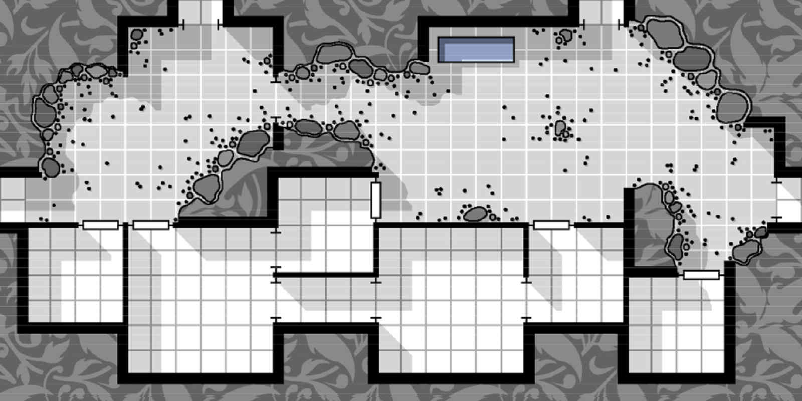

为了优化网络流量，推荐把多个小图标合并为一张大图：

### 上传图片资源

因为本服务器是最便宜的服务器，没有空间可以上传图片。
图片只能用第三方图床来外链。

以前新浪微博的图片可以外链，现在已经不能用了。
可以找一些速度慢免费的第三方图床，比如：路过图床 `https://imgtu.com/`

## 创建沙盘

### 注册登录

首先注册登录，过程略。

### 新建场景沙盘

每个沙盘的场景都以：「模组」、「地点」、「场景」作为唯一标识。比如：

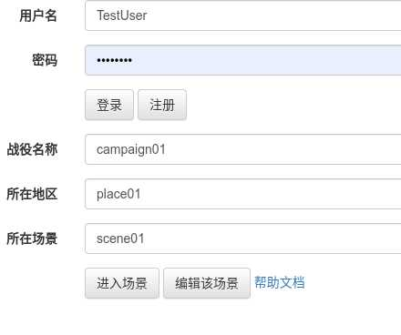

「深水城大冒险」「海拉斯特的地下城」「山下一层」

第一个使用新的模组名称的用户将作为该模组的拥有者与维护者，
其他人无法编辑任何使用该模组名的场景沙盘。

### 编辑沙盘

沙盘上所有的元素按使用过程中操作的频率分类为：

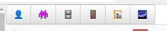

- 玩家
- 非完家生物
- 场景物品
- 门
- 墙壁
- 图片资源

### 图片资源

图片资源只在创建沙盘时用到，使用的频率较低。

#### 背景地图

点击图片资源的按钮，其中必须有一张名为 `map` 的图片，该图片是整个场景的地图背景：

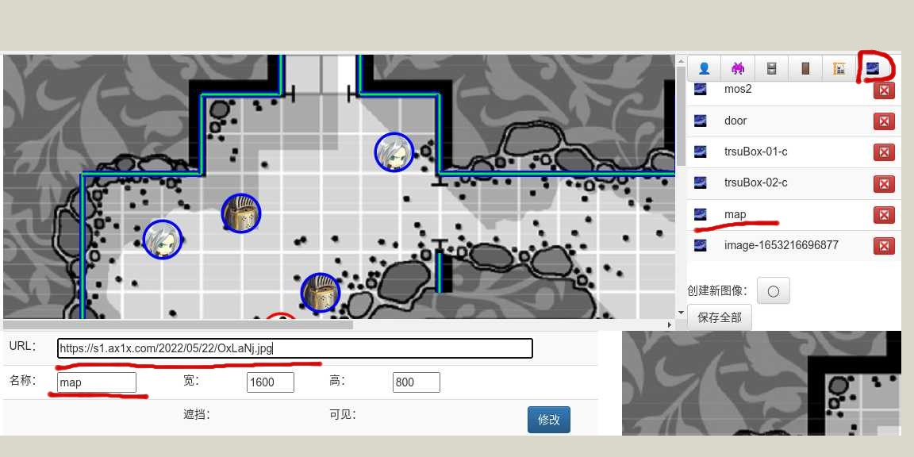

编辑器会为新创建的场景生成一张默认的 `map` 图片。
点击该图片，下方的编辑区中可以把图片的URL换成你场景中需要用到的地图。

#### 导入新图片资源

按下方的「创建新图像」按钮，会创建一个新的图片资源。
下方的编辑区中可以把图片的URL换成你场景中需要用到的图片。

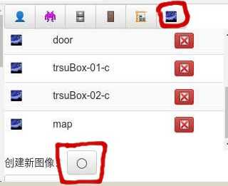

### 墙壁元素

墙壁元素只在创建沙盘时用到，使用的频率较低。

墙壁用来遮挡玩家的视线，有线条、圆形、方块三种按钮用来建立三种不同的墙壁。

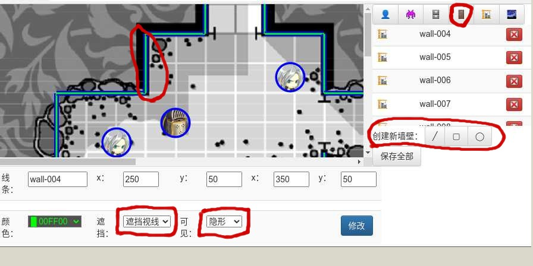

点击创建线条按钮后，再用鼠标点击沙盘，
拖动后放开会在该位置创建一个遮挡玩家的视线墙壁。

### 棋子元素

棋子元素在跑团过程会经常移动位置。
以下这些都是棋子元素：

- 玩家（代表玩家的棋子的ID必须与玩家注册的用户名一致）
- 非完家生物
- 场景物品
- 门

地图的编辑者可以通过在沙盘上点击或是在列表中选择的方式来选中棋子。
正文的编辑区域会显示棋子的属性，如位置、大小、图标、是否可见，
是否遮挡其他玩家的视线等。

#### 创建棋子

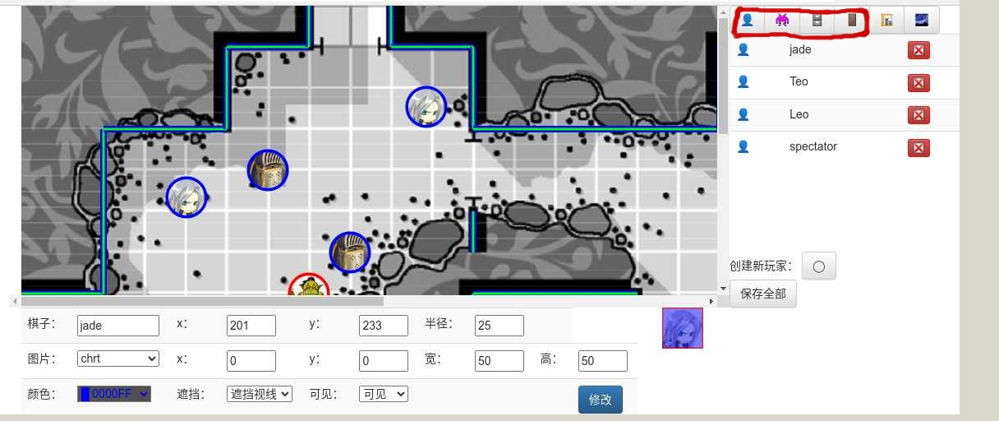

在列表中选择对应的棋子列表，列表下方会显示创建不同类型棋子的按钮。

点击创建按钮后，再用鼠标点击沙盘会在对应的位置创建棋子。

#### 棋子的图标

圆形与方形的棋子可以显示图标：

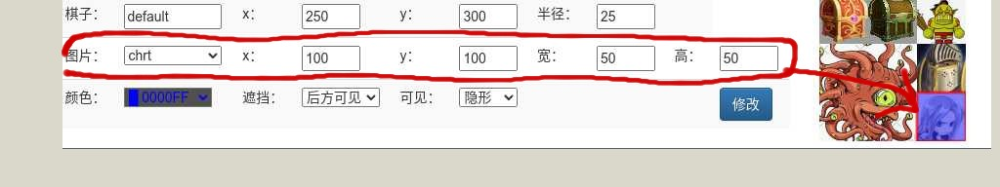

在编辑区域选择之前导入的图片资源，通过指定左上角的坐标与宽高，
会把右边图片资源中框出来的区域作为棋子的图标。

#### 控制棋子

- 通过编辑位置属性或是按 `Ctril` 加鼠标拖动的方式可以移动棋子的位置。
- 通过编辑大小属性或是按 `Alt` 加鼠标拖动的方式可以改变棋子的大小。

### 保存元素

点击「保存并发布」按钮保存编辑结果，并让所有玩家看到沙盘的变化：

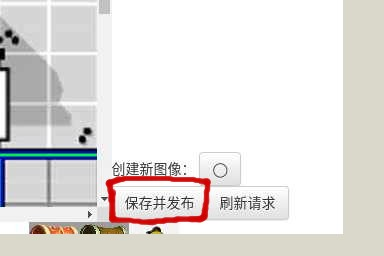

## 玩家操作

### 玩家登录

#### 团队成员玩家

团队成员玩家注册的用户名必须与对应棋子的ID一致，这样才能把自己的视野绑定到对应的棋子上，
关向DM发出移动棋子的请求：

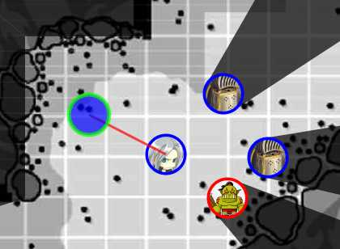

#### 旁观者

旁观者的视野被绑定在由DM创建的名为 `spectator` 的棋子上，该棋子的位置由DM控制：

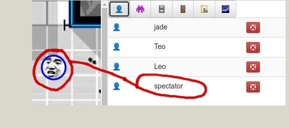

如果DM没有创建的名为 `spectator` 的棋子，那么旁观者打开沙盘时视野被固定在左上角。
这个位置很有可能神墙壁给卡住，什么也看不到：

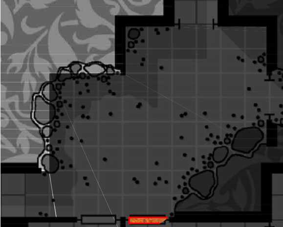

### 移动棋子

本沙盘工具没有碰撞体积检测功能，所以棋子的移动是否符合移动范围与地形条件全靠人工判断。
所以玩家只能提出移动棋子的请求，然后DM来裁定是否可以移动到指定位置。

#### 玩家出称动棋子的请求

玩家按住「Ctrl」加鼠标拖动棋子的操作，在沙盘上标示出想要移动的目标位置：

玩家如果想要撤消请求，直接鼠标点代表目的地的圆圈即可。
撤消请求以后可以再次拖动，发出新的请求。

#### DM裁定玩家的请求

因为服务器资源限制，为了减少请求的数量与网络流量。需要DM手动按刷新请求按钮：

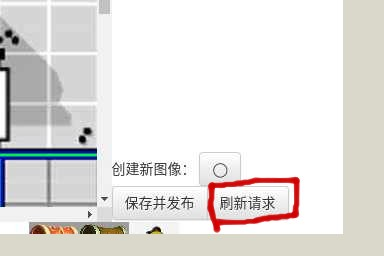

可以在沙盘上看到所有玩家提出的移动请求：

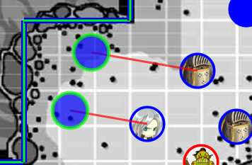

DM按「Ctrl」加鼠标拖动棋子的操作可以直接操作棋子。

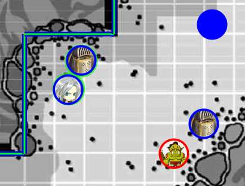

如果DM有异议，直接通过聊天与玩家讨论，讨论完后再移动。

#### DM发布沙盘的变化

移动棋子完成以后，DM点击「保存并发布」按钮保存编辑结果。把修改后的沙盘广播给各位玩家：

#### 玩家刷新沙盘

因为服务器资源限制，为了减少请求的数量与网络流量。需要玩家刷新网页（按F5或
Ctrl+R都可以）才能看到新的位置与在新位置的视野范围内看到的新界面：

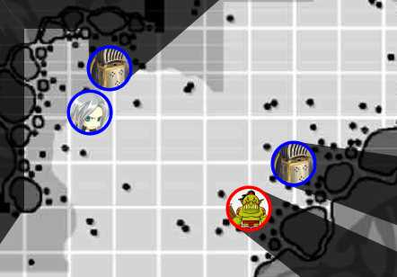

### 投骰与检定

为了防止玩家重复多次投骰子的操作。
服务器只会记录在DM设定了对应对应玩家ID的检定阈值以后第一次投骰操作的结果。

如果玩家的操作有误，必须要DM重新设置阈值以后，重新投骰的结果才会被服务器记录。

#### DM指定玩家检定

DM选择一名玩家进行检定，并输入指定通过的阈值后，按「加车键」发出请求：

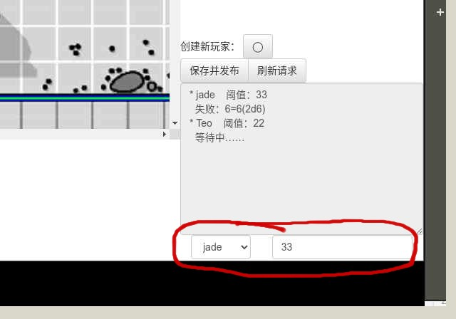

#### DM查看玩家检定结果

DM鼠标点击文本框，查看玩家投骰的结果：

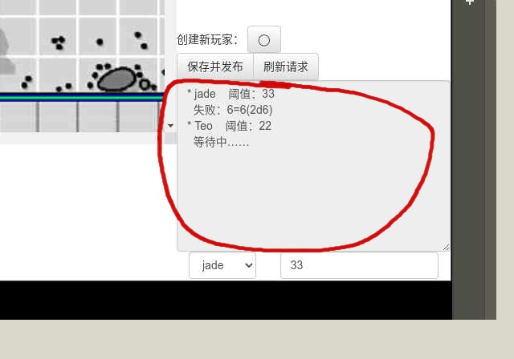

第一条记录包括：玩家的ID、通过的阈值、是否成功、投骰子的详细信息。

#### 玩家检定

玩家直接在文本框中输入表达式并按回车键投骰。例如：2d6+1d4+3

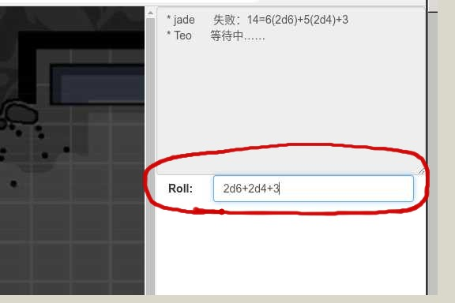

玩家也可以通过鼠标点击文本框查看投骰结果，但是看不到DM设置的阈值。
只能看到是否成功与详细数值：

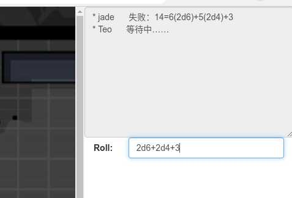
